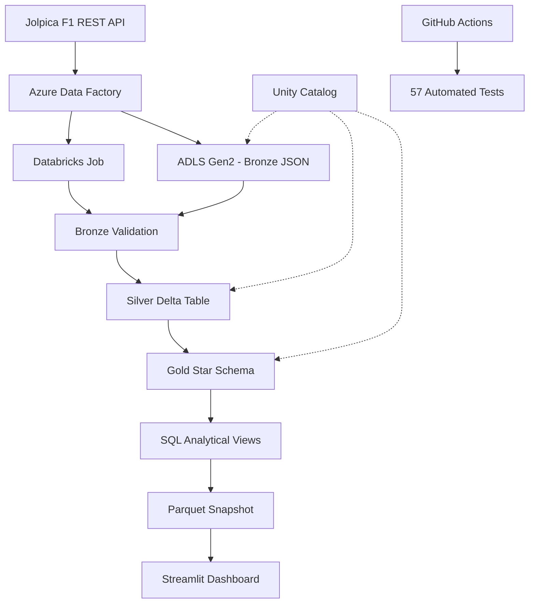
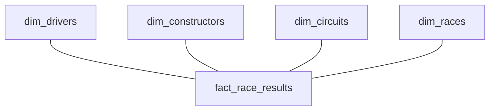
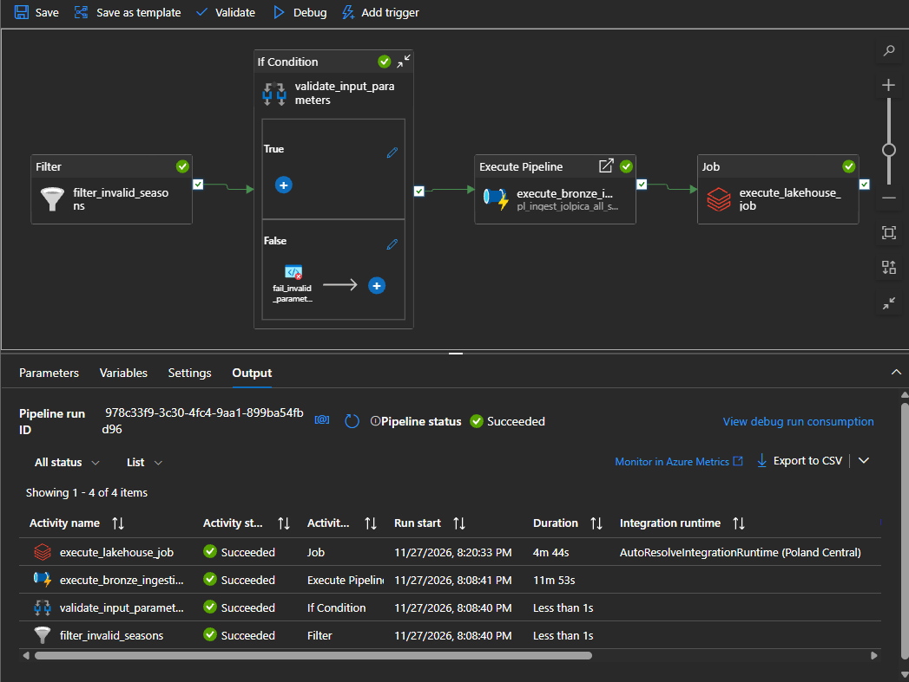
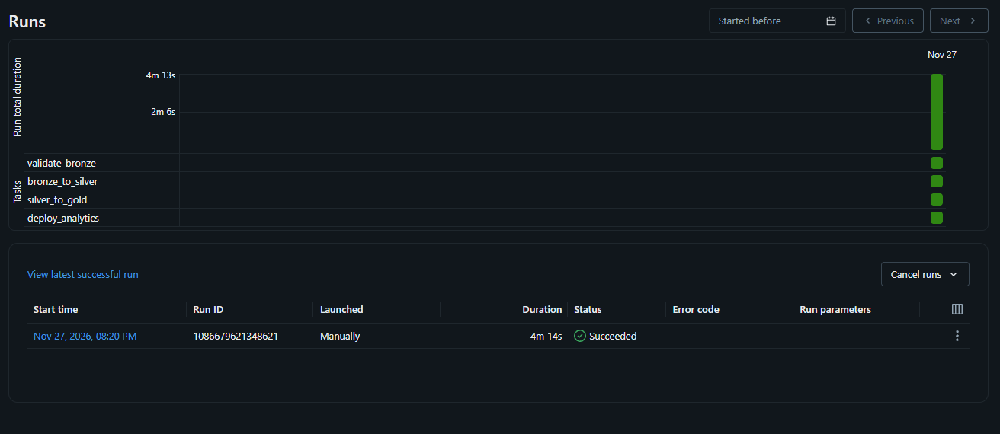

# F1 Performance Analytics – Azure Data Lakehouse

[English](README.md) | [Polski](README.pl.md)


An end-to-end Data Engineering portfolio project implementing a cloud-based lakehouse for historical Formula 1 performance analytics using Microsoft Azure.

**Project status:** MVP Completed – v1.0.0

## 1. Project Overview

The project demonstrates the complete data lifecycle, from REST API ingestion through data transformation, dimensional modeling, SQL analytics, automated testing and interactive data visualization.

The solution follows the Medallion Architecture and uses Azure-managed services to provide a reproducible batch processing workflow.

The interactive dashboard can be executed locally without Azure credentials.

## 2. Business Problem

Raw Formula 1 race results are not directly optimized for analytical exploration.

The project transforms historical racing data into a consistent, validated analytical model capable of answering the following questions:

- How has a driver performed in their last N races?
- Which circuits provide the strongest historical results for a driver?
- How many positions does a driver gain or lose?
- How does driver performance change across seasons?
- Which constructors perform best at a selected circuit?

## 3. Project Results

| Metric | Validated MVP baseline |
|---|---:|
| Historical seasons | 2021–2025 |
| Grand Prix races | 114 |
| Drivers | 35 |
| Constructors | 12 |
| Circuits | 28 |
| Bronze JSON files | 25 |
| Silver records | 2,278 |
| Gold fact records | 2,278 |
| Gold dimensions | 4 |
| SQL analytical views | 6 |
| Locally passed automated tests | 57 |
| Duplicate business keys | 0 |
| Orphan foreign keys | 0 |

These values represent the historical development and validation dataset.

## 4. Solution Architecture



### Medallion Architecture

| Layer | Responsibility | Format |
|---|---|---|
| Bronze | Raw API responses and ingestion metadata | JSON |
| Silver | Cleaned, normalized and validated race results | Delta Lake |
| Gold | Business-ready dimensional model | Delta Lake |
| Analytics | Reusable business metrics | SQL Views |
| Serving | Portable analytical dataset | Parquet |

See [Solution Architecture](docs/architecture.md).

## 5. Technology Stack

| Technology | Purpose |
|---|---|
| Python | Reusable transformation and application logic |
| PySpark | Distributed data processing |
| SQL | Business analytics and validation |
| Azure Data Factory | Data ingestion and orchestration |
| ADLS Gen2 | Data lake storage |
| Azure Databricks | Serverless data processing |
| Delta Lake | Transactional tables and version history |
| Unity Catalog | Data governance |
| Managed Identity | Azure authentication |
| Azure RBAC | Access authorization |
| Streamlit | Interactive analytical dashboard |
| Pandas | Local analytical processing |
| Plotly | Interactive visualizations |
| PyArrow | Parquet serialization |
| Pytest | Automated testing |
| GitHub Actions | Continuous integration |

## 6. Data Source and Data Grain

Historical race data is obtained from the [Jolpica F1 API](https://github.com/jolpica/jolpica-f1).

The current dataset covers Grand Prix race results from the 2021–2025 seasons.

The Silver and Gold fact datasets contain one record per driver per race.

Silver business key:

`season + round + driver_id`

Gold fact business key:

`race_id + driver_id`

Sprint and qualifying results are outside the current MVP scope.

Aggregated race points should not be interpreted as official championship standings.

See [Data Source Documentation](docs/data_source.md).

## 7. Gold Dimensional Model

The Gold layer implements a star schema.



The dimensional model separates descriptive entities from race-level performance metrics.

See [Gold Dimensional Model](docs/gold_dimensional_model.md).

## 8. SQL Business Analytics

The analytics layer contains six reusable SQL views.

| View | Purpose |
|---|---|
| vw_race_results | Base analytical dataset |
| vw_driver_circuit_history | Recent circuit performance |
| vw_driver_circuit_performance | Driver circuit comparison |
| vw_driver_positions_gained | Grid position improvement |
| vw_driver_season_performance | Historical season trends |
| vw_constructor_circuit_performance | Constructor circuit comparison |

Example query:

```sql
SELECT
    circuit_name,
    race_starts,
    total_points,
    avg_points_per_start
FROM f1_lakehouse.analytics.vw_driver_circuit_performance
WHERE driver_id = 'max_verstappen'
    AND race_starts >= 3
ORDER BY avg_points_per_start DESC;
```

See [SQL Business Analytics](docs/sql_business_analytics.md).

## 9. End-to-End Pipeline

Azure Data Factory orchestrates ingestion and Databricks Job execution.

The pipeline supports full historical loading and selected season refresh.





### Observed Execution Performance

| Execution mode | Duration |
|---|---|
| Full historical load | 16m 37s |
| Selected season refresh | 6m 53s |
| Observed time reduction | 58.6% |

The measurements represent individual development test runs.

Selected season refresh reduces ingestion work, while Silver and Gold still rebuild the complete historical dataset.

See [End-to-End Pipeline](docs/end_to_end_pipeline.md).

## 10. Interactive Dashboard


The Streamlit dashboard provides:

- Interactive driver and circuit filters.
- Last N race selection.
- Dynamic performance KPIs.
- Points and finishing position charts.
- Grid versus finishing position comparison.
- Detailed race results.
- Circuit and constructor performance analysis.
- Filtered CSV export.
- Dataset refresh metadata.

The dashboard uses a curated Parquet snapshot containing 2,278 race results and 38 columns.

No live Azure connection is required.

See [Dashboard Documentation](dashboard/README.md) and [Portfolio Demo](docs/portfolio_demo.md).

## 11. Quick Start

Requirements:

- Python 3.12
- Git

Clone the repository:

```bash
git clone https://github.com/mati290/f1-azure-data-lakehouse.git
cd f1-azure-data-lakehouse
```

Create a virtual environment:

```bash
python -m venv .venv
```

Activate on Windows:

```powershell
.venv\Scripts\Activate.ps1
```

Activate on Linux or macOS:

```bash
source .venv/bin/activate
```

Install dashboard dependencies:

```bash
python -m pip install -r dashboard/requirements.txt
```

Start the application:

```bash
python -m streamlit run dashboard/app.py
```

Open http://localhost:8501.

For complete cloud deployment and local testing instructions, see [Setup and Reproducibility](docs/setup.md).

## 12. Data Quality and Testing

The project implements validation across Bronze, Silver, Gold, analytics and dashboard serving.

| Test suite | Tests |
|---|---:|
| PySpark transformations and data quality | 21 |
| Dashboard | 36 |
| Total | 57 |

The complete suite passed locally during MVP development.

Additional cloud validation covers business key uniqueness, referential integrity, points reconciliation, record counts and Delta content-level idempotency.

To run all automated tests, install Java 17 and execute:

```bash
python -m pip install -r requirements-dev.txt
python -m pip install -r dashboard/requirements.txt
python -m pytest -q
```

GitHub Actions executes the automated tests on supported pushes and pull requests.

See [Data Quality and CI](docs/data_quality_and_ci.md).

## 13. Costs and Security

The development environment uses:

- Azure for Students.
- A monthly budget of 10 USD or equivalent.
- Budget alerts at 50%, 80% and 100%.
- Serverless compute.
- Manual pipeline execution.
- Private storage containers.
- Managed Identity authentication.
- Scoped Azure RBAC permissions.
- Unity Catalog governance.

The budget is a monitoring threshold, not a guaranteed spending limit.

Actual execution costs have not been independently measured for this documentation.

See [Costs, Security and Technical Trade-offs](docs/costs_security_tradeoffs.md).

## 14. Repository Structure

```text
f1-azure-data-lakehouse/
├── .github/workflows/
├── .streamlit/
├── adf/
├── dashboard/
│   ├── data/
│   └── tests/
├── data/sample/
├── databricks/jobs/
├── docs/
│   ├── images/
│   ├── pl/
│   └── screenshots/
├── notebooks/
├── sql/
├── src/
├── tests/
├── README.md
├── README.pl.md
├── requirements.txt
├── requirements-dev.txt
└── pytest.ini
```

## 15. Documentation

| Document | English | Polski |
|---|---|---|
| Architecture | [EN](docs/architecture.md) | [PL](docs/pl/architecture.md) |
| Setup and reproducibility | [EN](docs/setup.md) | [PL](docs/pl/setup.md) |
| SQL analytics | [EN](docs/sql_business_analytics.md) | [PL](docs/pl/sql_business_analytics.md) |
| Data quality and CI | [EN](docs/data_quality_and_ci.md) | [PL](docs/pl/data_quality_and_ci.md) |
| Portfolio demo | [EN](docs/portfolio_demo.md) | [PL](docs/pl/portfolio_demo.md) |
| Costs and security | [EN](docs/costs_security_tradeoffs.md) | [PL](docs/pl/costs_security_tradeoffs.md) |
| Dashboard | [EN](dashboard/README.md) | [PL](dashboard/README.pl.md) |
| Future roadmap | [EN](docs/roadmap.md) | [PL](docs/pl/roadmap.md) |

### Detailed Implementation Documentation

- [Azure Environment Setup](docs/azure_setup.md)
- [Data Source](docs/data_source.md)
- [Bronze Ingestion](docs/bronze_ingestion.md)
- [Silver Transformations](docs/silver_transformations.md)
- [Gold Dimensional Model](docs/gold_dimensional_model.md)
- [End-to-End Pipeline](docs/end_to_end_pipeline.md)

## 16. MVP Delivery Status

| Feature | Status |
|---|---|
| F01 – Project initialization | Completed |
| F02 – REST API exploration | Completed |
| F03 – Azure environment setup | Completed |
| F04 – Bronze ingestion | Completed |
| F05 – Silver transformations | Completed |
| F06 – Gold dimensional model | Completed |
| F07 – SQL analytics | Completed |
| F08 – Pipeline orchestration | Completed |
| F09 – Data quality and CI | Completed |
| F10 – Streamlit dashboard | Completed |
| F11 – Portfolio documentation | Completed |

## 17. Limitations and Future Development

The MVP intentionally uses batch processing, full-refresh transformations, manual infrastructure configuration and a static dashboard snapshot.

Real-time streaming, incremental processing, production-grade network isolation and automated cloud deployment are outside the current scope.

Future enhancements are documented separately in the [Project Roadmap](docs/roadmap.md).

## 18. License and Attribution

Project source code is licensed under the [MIT License](LICENSE).

External data remains subject to its respective source terms.

Historical Formula 1 data is provided by Jolpica F1 API. See [Dataset Attribution and License](dashboard/data/README.md).

This is an independent, non-commercial educational portfolio project and is not officially affiliated with Formula 1 or the FIA.