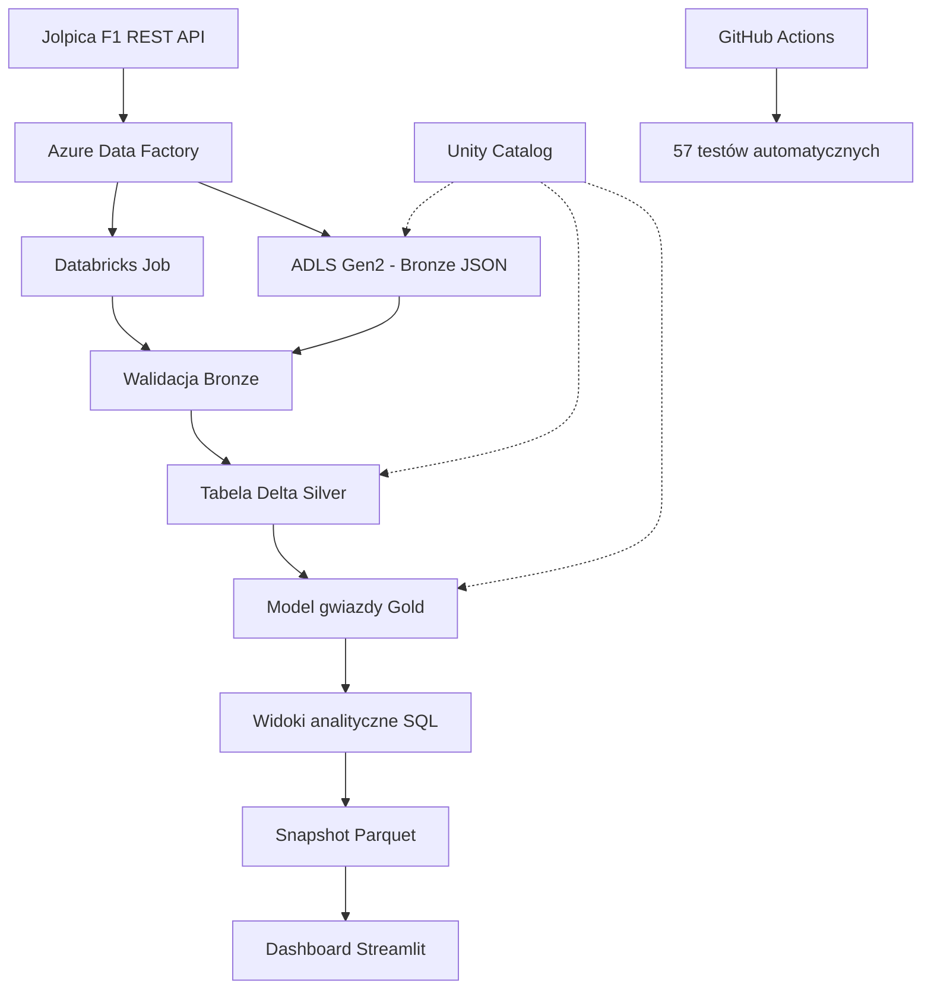
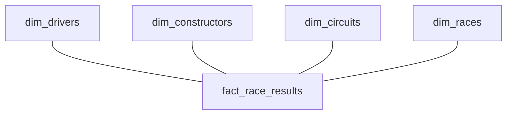
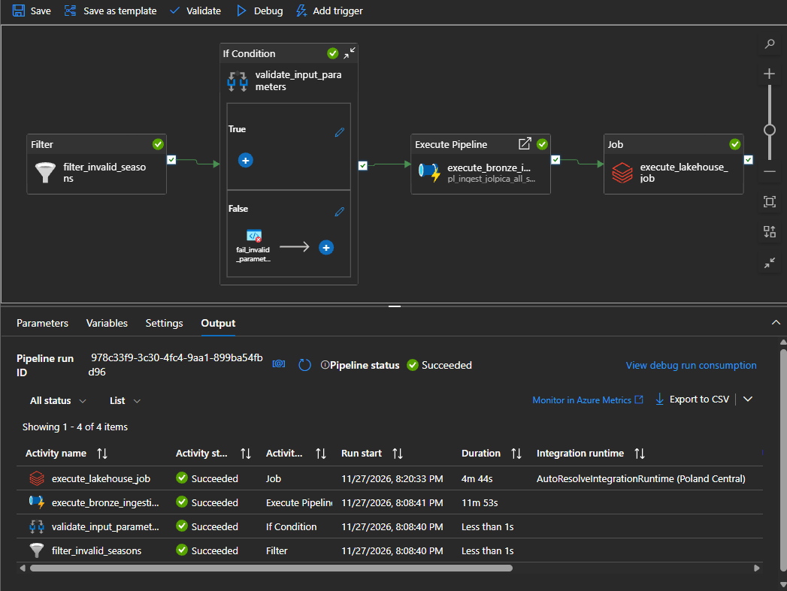
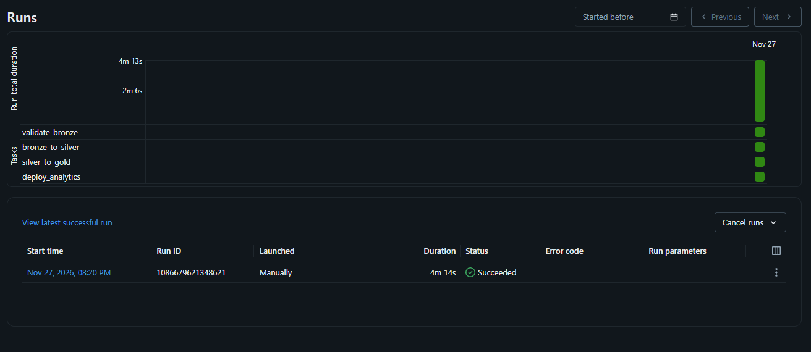

# F1 Performance Analytics – Azure Data Lakehouse

[English](README.md) | [Polski](README.pl.md)


Kompleksowy projekt portfolio Data Engineering implementujący chmurową architekturę Lakehouse do analizy historycznych wyników Formuły 1 z wykorzystaniem Microsoft Azure.

**Status projektu:** MVP ukończone – v1.0.0

## 1. Opis projektu

Projekt demonstruje pełny cykl życia danych: od pobierania danych z REST API, przez transformacje, modelowanie wymiarowe, analitykę SQL i testy automatyczne, aż po interaktywną wizualizację.

Rozwiązanie wykorzystuje Medallion Architecture oraz zarządzane usługi Azure w celu realizacji odtwarzalnego przetwarzania wsadowego.

Interaktywny dashboard można uruchomić lokalnie bez danych uwierzytelniających Azure.

## 2. Problem biznesowy

Surowe wyniki wyścigów Formuły 1 nie są bezpośrednio zoptymalizowane pod kątem analizy danych.

Projekt przekształca historyczne dane wyścigowe w spójny i zweryfikowany model analityczny, umożliwiający odpowiedź na następujące pytania:

- Jak kierowca radził sobie w ostatnich N wyścigach?
- Na których torach kierowca osiąga najlepsze historyczne wyniki?
- Ile pozycji kierowca zyskuje lub traci?
- Jak zmieniają się wyniki kierowcy w kolejnych sezonach?
- Którzy konstruktorzy osiągają najlepsze wyniki na wybranym torze?

## 3. Wyniki projektu

| Metryka | Zweryfikowany stan bazowy MVP |
|---|---:|
| Sezony historyczne | 2021–2025 |
| Wyścigi Grand Prix | 114 |
| Kierowcy | 35 |
| Konstruktorzy | 12 |
| Tory | 28 |
| Pliki JSON Bronze | 25 |
| Rekordy Silver | 2 278 |
| Rekordy faktów Gold | 2 278 |
| Wymiary Gold | 4 |
| Widoki analityczne SQL | 6 |
| Lokalnie zaliczone testy | 57 |
| Zduplikowane klucze biznesowe | 0 |
| Klucze obce bez dopasowania | 0 |

Wartości dotyczą historycznego zbioru wykorzystanego podczas prac deweloperskich i walidacyjnych.

## 4. Architektura rozwiązania



### Medallion Architecture

| Warstwa | Odpowiedzialność | Format |
|---|---|---|
| Bronze | Surowe odpowiedzi API i metadane | JSON |
| Silver | Oczyszczone i zweryfikowane wyniki | Delta Lake |
| Gold | Model wymiarowy gotowy do analiz | Delta Lake |
| Analytics | Wielokrotnego użytku metryki biznesowe | Widoki SQL |
| Serving | Przenośny zbiór analityczny | Parquet |

Zobacz [architekturę rozwiązania](docs/pl/architecture.md).

## 5. Wykorzystane technologie

| Technologia | Przeznaczenie |
|---|---|
| Python | Logika transformacji i aplikacji |
| PySpark | Rozproszone przetwarzanie danych |
| SQL | Analityka biznesowa i walidacja |
| Azure Data Factory | Pobieranie danych i orkiestracja |
| ADLS Gen2 | Magazyn danych |
| Azure Databricks | Przetwarzanie Serverless |
| Delta Lake | Transakcyjne tabele i historia wersji |
| Unity Catalog | Zarządzanie danymi i dostępem |
| Managed Identity | Uwierzytelnianie Azure |
| Azure RBAC | Autoryzacja dostępu |
| Streamlit | Interaktywny dashboard |
| Pandas | Lokalne przetwarzanie analityczne |
| Plotly | Interaktywne wizualizacje |
| PyArrow | Serializacja Parquet |
| Pytest | Testy automatyczne |
| GitHub Actions | Ciągła integracja |

## 6. Źródło i granularność danych

Historyczne dane wyścigowe pochodzą z [Jolpica F1 API](https://github.com/jolpica/jolpica-f1).

Aktualny zbiór obejmuje wyniki Grand Prix z sezonów 2021–2025.

Warstwa Silver oraz tabela faktów Gold zawierają jeden rekord na kierowcę w danym wyścigu.

Klucz biznesowy Silver:

`season + round + driver_id`

Klucz biznesowy Gold:

`race_id + driver_id`

Wyniki sprintów i kwalifikacji pozostają poza zakresem MVP.

Zagregowane punkty wyścigowe nie stanowią oficjalnej klasyfikacji mistrzostw.

Zobacz [dokumentację źródła danych (EN)](docs/data_source.md).

## 7. Model wymiarowy Gold

Warstwa Gold implementuje schemat gwiazdy.



Model wymiarowy oddziela encje opisowe od metryk na poziomie wyników wyścigów.

Zobacz [model wymiarowy Gold (EN)](docs/gold_dimensional_model.md).

## 8. Analityka biznesowa SQL

Warstwa analityczna zawiera sześć widoków SQL.

| Widok | Przeznaczenie |
|---|---|
| vw_race_results | Bazowy zbiór analityczny |
| vw_driver_circuit_history | Ostatnie wyniki na torze |
| vw_driver_circuit_performance | Porównanie wyników na torach |
| vw_driver_positions_gained | Zmiana pozycji |
| vw_driver_season_performance | Trendy sezonowe |
| vw_constructor_circuit_performance | Porównanie konstruktorów |

Przykładowe zapytanie:

```sql
SELECT
    circuit_name,
    race_starts,
    total_points,
    avg_points_per_start
FROM f1_lakehouse.analytics.vw_driver_circuit_performance
WHERE driver_id = 'max_verstappen'
    AND race_starts >= 3
ORDER BY avg_points_per_start DESC;
```

Zobacz [analitykę biznesową SQL](docs/pl/sql_business_analytics.md).

## 9. Pipeline End-to-End

Azure Data Factory orkiestruje pobieranie danych oraz wykonanie Databricks Job.

Pipeline obsługuje pełne ładowanie historyczne i odświeżanie wybranych sezonów.





### Zaobserwowana wydajność

| Tryb wykonania | Czas |
|---|---|
| Pełne ładowanie historyczne | 16 min 37 s |
| Odświeżenie wybranego sezonu | 6 min 53 s |
| Zaobserwowana redukcja czasu | 58,6% |

Pomiary dotyczą pojedynczych wykonań deweloperskich.

Odświeżanie sezonu ogranicza pobieranie danych, natomiast Silver i Gold nadal przebudowują kompletny zbiór historyczny.

Zobacz [pipeline End-to-End (EN)](docs/end_to_end_pipeline.md).

## 10. Interaktywny dashboard


Dashboard Streamlit oferuje:

- Interaktywne filtry kierowców i torów.
- Wybór ostatnich N wyścigów.
- Dynamiczne wskaźniki KPI.
- Wykresy punktów i pozycji końcowych.
- Porównanie pozycji startowej i końcowej.
- Szczegółowe wyniki wyścigów.
- Analizę wyników na torach i w zespołach.
- Eksport przefiltrowanych danych do CSV.
- Metadane aktualności zbioru.

Dashboard wykorzystuje przygotowany snapshot Parquet zawierający 2 278 wyników i 38 kolumn.

Nie wymaga aktywnego połączenia z Azure.

Zobacz [dokumentację dashboardu](dashboard/README.pl.md) oraz [demonstrację portfolio](docs/pl/portfolio_demo.md).

## 11. Szybkie uruchomienie

Wymagania:

- Python 3.12
- Git

Sklonuj repozytorium:

```bash
git clone https://github.com/mati290/f1-azure-data-lakehouse.git
cd f1-azure-data-lakehouse
```

Utwórz środowisko wirtualne:

```bash
python -m venv .venv
```

Aktywacja w systemie Windows:

```powershell
.venv\Scripts\Activate.ps1
```

Aktywacja w systemie Linux lub macOS:

```bash
source .venv/bin/activate
```

Zainstaluj zależności dashboardu:

```bash
python -m pip install -r dashboard/requirements.txt
```

Uruchom aplikację:

```bash
python -m streamlit run dashboard/app.py
```

Otwórz http://localhost:8501.

Pełna instrukcja wdrożenia i testowania znajduje się w dokumencie [Konfiguracja i odtwarzalność](docs/pl/setup.md).

## 12. Jakość danych i testowanie

Projekt implementuje walidację warstw Bronze, Silver, Gold, Analytics oraz danych dashboardu.

| Zestaw testów | Liczba |
|---|---:|
| Transformacje PySpark i jakość danych | 21 |
| Dashboard | 36 |
| Łącznie | 57 |

Pełny zestaw testów został zaliczony lokalnie podczas realizacji MVP.

Dodatkowa walidacja chmurowa obejmuje unikalność kluczy biznesowych, integralność referencyjną, uzgadnianie punktów, liczby rekordów oraz idempotentność zawartości Delta.

Aby uruchomić wszystkie testy, zainstaluj Java 17 i wykonaj:

```bash
python -m pip install -r requirements-dev.txt
python -m pip install -r dashboard/requirements.txt
python -m pytest -q
```

GitHub Actions wykonuje testy automatyczne podczas obsługiwanych operacji push i Pull Request.

Zobacz [jakość danych i CI](docs/pl/data_quality_and_ci.md).

## 13. Koszty i bezpieczeństwo

Środowisko deweloperskie wykorzystuje:

- Azure for Students.
- Budżet miesięczny 10 USD lub równowartość.
- Alerty budżetowe 50%, 80% i 100%.
- Serverless Compute.
- Ręczne uruchamianie pipeline'u.
- Prywatne kontenery danych.
- Uwierzytelnianie Managed Identity.
- Uprawnienia Azure RBAC o ograniczonym zakresie.
- Zarządzanie dostępem przez Unity Catalog.

Budżet jest progiem monitorowania, a nie gwarantowanym limitem wydatków.

Rzeczywiste koszty pojedynczych wykonań nie zostały niezależnie zmierzone na potrzeby dokumentacji.

Zobacz [koszty, bezpieczeństwo i kompromisy techniczne](docs/pl/costs_security_tradeoffs.md).

## 14. Struktura repozytorium

```text
f1-azure-data-lakehouse/
├── .github/workflows/
├── .streamlit/
├── adf/
├── dashboard/
│   ├── data/
│   └── tests/
├── data/sample/
├── databricks/jobs/
├── docs/
│   ├── images/
│   ├── pl/
│   └── screenshots/
├── notebooks/
├── sql/
├── src/
├── tests/
├── README.md
├── README.pl.md
├── requirements.txt
├── requirements-dev.txt
└── pytest.ini
```

## 15. Dokumentacja

| Dokument | English | Polski |
|---|---|---|
| Architektura | [EN](docs/architecture.md) | [PL](docs/pl/architecture.md) |
| Konfiguracja i odtwarzalność | [EN](docs/setup.md) | [PL](docs/pl/setup.md) |
| Analityka SQL | [EN](docs/sql_business_analytics.md) | [PL](docs/pl/sql_business_analytics.md) |
| Jakość danych i CI | [EN](docs/data_quality_and_ci.md) | [PL](docs/pl/data_quality_and_ci.md) |
| Demonstracja portfolio | [EN](docs/portfolio_demo.md) | [PL](docs/pl/portfolio_demo.md) |
| Koszty i bezpieczeństwo | [EN](docs/costs_security_tradeoffs.md) | [PL](docs/pl/costs_security_tradeoffs.md) |
| Dashboard | [EN](dashboard/README.md) | [PL](dashboard/README.pl.md) |
| Roadmapa | [EN](docs/roadmap.md) | [PL](docs/pl/roadmap.md) |

### Szczegółowa dokumentacja implementacji (EN)

- [Konfiguracja Azure](docs/azure_setup.md)
- [Źródło danych](docs/data_source.md)
- [Pobieranie Bronze](docs/bronze_ingestion.md)
- [Transformacje Silver](docs/silver_transformations.md)
- [Model wymiarowy Gold](docs/gold_dimensional_model.md)
- [Pipeline End-to-End](docs/end_to_end_pipeline.md)

## 16. Status realizacji MVP

| Funkcjonalność | Status |
|---|---|
| F01 – Inicjalizacja projektu | Zakończona |
| F02 – Eksploracja REST API | Zakończona |
| F03 – Konfiguracja Azure | Zakończona |
| F04 – Pobieranie Bronze | Zakończona |
| F05 – Transformacje Silver | Zakończona |
| F06 – Model wymiarowy Gold | Zakończona |
| F07 – Analityka SQL | Zakończona |
| F08 – Orkiestracja pipeline'u | Zakończona |
| F09 – Jakość danych i CI | Zakończona |
| F10 – Dashboard Streamlit | Zakończona |
| F11 – Dokumentacja portfolio | Zakończona |

## 17. Ograniczenia i dalszy rozwój

MVP celowo wykorzystuje przetwarzanie wsadowe, pełne odświeżanie danych, ręczną konfigurację infrastruktury i statyczny snapshot dashboardu.

Przetwarzanie strumieniowe, transformacje przyrostowe, produkcyjna izolacja sieciowa i automatyczne wdrażanie chmurowe pozostają poza aktualnym zakresem.

Przyszłe usprawnienia opisano oddzielnie w [roadmapie projektu](docs/pl/roadmap.md).

## 18. Licencja i źródła

Kod źródłowy projektu jest udostępniony na podstawie [licencji MIT](LICENSE).

Dane zewnętrzne podlegają warunkom ich dostawców.

Historyczne dane Formuły 1 pochodzą z Jolpica F1 API. Zobacz [informacje o źródle i licencji zbioru](dashboard/data/README.md).

Projekt jest niezależnym, niekomercyjnym projektem edukacyjnym i nie jest oficjalnie powiązany z Formułą 1 ani FIA.