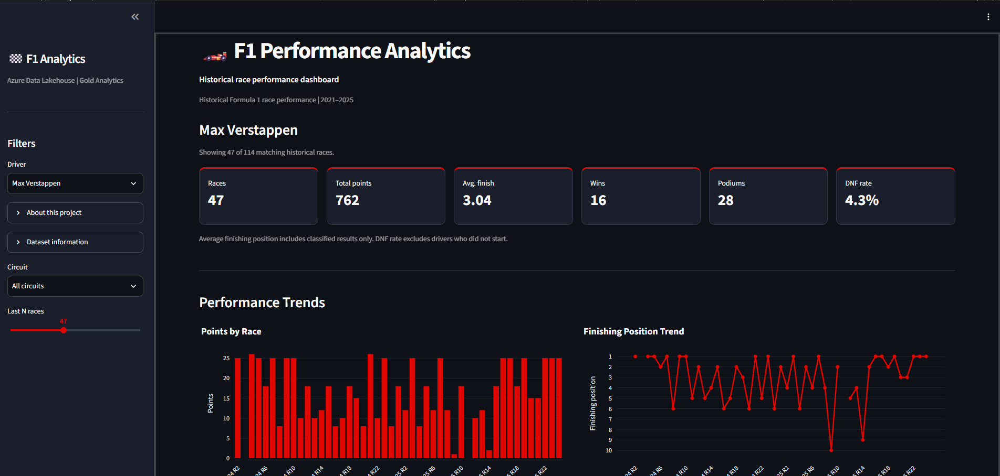
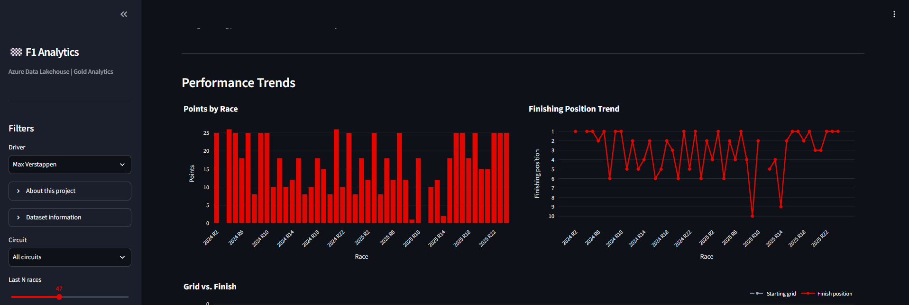
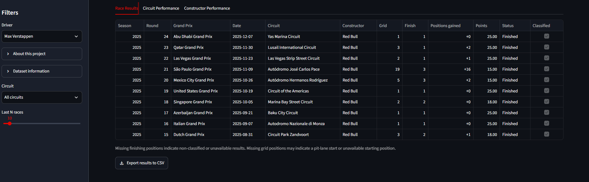
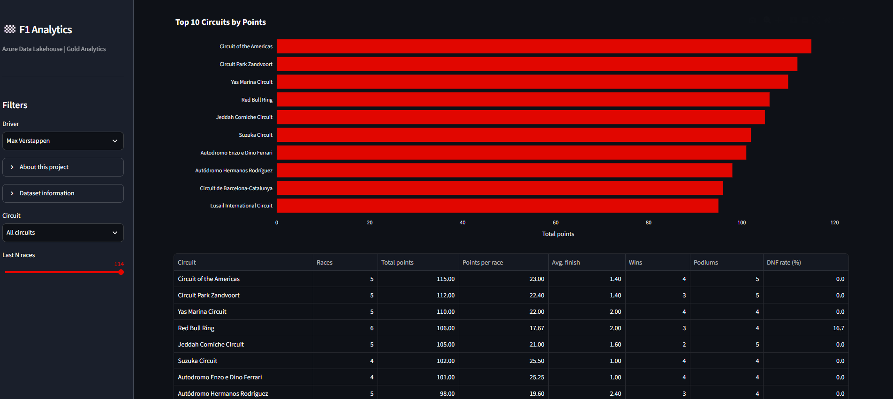
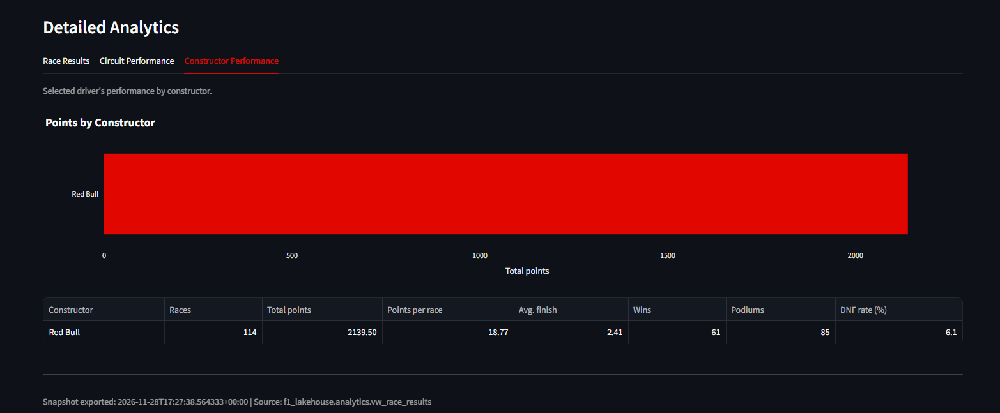
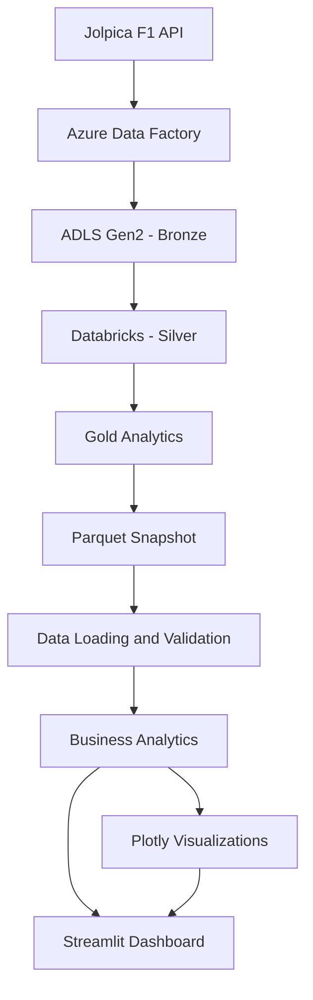

# F1 Performance Analytics Dashboard

[English](README.md) | [Polski](README.pl.md)

An interactive Formula 1 analytics dashboard built on top of the Gold layer of the Azure Data Lakehouse project.

The dashboard demonstrates how curated analytical datasets can be transformed into an interactive, business-oriented data product without requiring direct access to cloud infrastructure.

## Features

- Interactive driver and circuit filters
- Configurable historical race selection
- Dynamic driver performance KPIs
- Points per race visualization
- Finishing position trends
- Starting grid vs. finishing position comparison
- Detailed race results
- Circuit performance analysis
- Constructor performance analysis
- Filtered CSV export
- Dataset refresh information
- Graceful handling of empty and non-classified results

## Dashboard Preview

### Overview



### Performance Trends



### Race Results



### Circuit Performance



### Constructor Performance



## Dataset

| Property | Value |
|---|---|
| Source API | Jolpica F1 API |
| Source layer | Gold |
| Source view | `f1_lakehouse.analytics.vw_race_results` |
| Historical seasons | 2021–2025 |
| Initial snapshot records | 2,278 |
| Columns | 38 |
| Storage format | Apache Parquet |
| Compression | Snappy |
| Refresh strategy | Manual snapshot export |

The dashboard uses a curated Gold snapshot stored in the repository. No Azure credentials or active Databricks compute resources are required to run the application.

## Architecture



## Technology Stack

- Python
- Streamlit
- Pandas
- Plotly
- Apache Parquet
- PyArrow
- Pytest

## Run Locally

Clone the repository:

```bash
git clone https://github.com/mati290/f1-azure-data-lakehouse.git
cd f1-azure-data-lakehouse
```

Create a virtual environment:

```bash
python -m venv .venv
```

Activate the environment on Windows:

```powershell
.venv\Scripts\Activate.ps1
```

On Linux or macOS:

```bash
source .venv/bin/activate
```

Install dashboard dependencies:

```bash
python -m pip install -r dashboard/requirements.txt
```

Start the application from the repository root:

```bash
python -m streamlit run dashboard/app.py
```

Open the dashboard at:

http://localhost:8501

## Project Structure

```text
dashboard/
├── app.py
├── analytics.py
├── charts.py
├── data_loader.py
├── styles.py
├── requirements.txt
├── README.md
├── data/
│   ├── race_results.parquet
│   ├── metadata.json
│   └── README.md
└── tests/
    ├── conftest.py
    ├── test_analytics.py
    ├── test_data_loader.py
    └── test_charts.py
```

## Business Metric Definitions

| Metric | Definition |
|---|---|
| Races | Number of distinct race results for the selected driver |
| Total points | Sum of points across selected race results |
| Average finish | Average finishing position for classified results |
| Wins | Number of race victories |
| Podiums | Number of podium finishes |
| DNF rate | DNF results divided by starts, expressed as a percentage |
| Points per race | Total points divided by the number of selected races |

The last N races filter is applied after the driver and circuit filters.

Constructor performance represents the selected driver's results with each constructor rather than the entire team's performance.

Non-classified finishing positions are excluded from average finishing position calculations and displayed as missing values in position charts.

## Testing

The dashboard includes automated tests covering:

- Data loading and schema validation
- Business key uniqueness
- Snapshot metadata consistency
- Driver and circuit filters
- KPI calculations
- Empty result handling
- Circuit and constructor aggregations
- Plotly chart generation

Run the dashboard test suite:

```bash
python -m pip install pytest
python -m pytest dashboard/tests -v
```

## Limitations

- The dashboard uses a static historical snapshot rather than live data.
- The current snapshot covers seasons 2021–2025.
- Snapshot updates require a new export from the Gold analytics layer.
- Missing and non-classified results are handled according to the curated Gold data model.

## Data Attribution

Historical Formula 1 data is sourced from the Jolpica F1 API.

https://github.com/jolpica/jolpica-f1

See [Dataset Documentation](data/README.md) for additional attribution and licensing information.

This is an unofficial, non-commercial educational Data Engineering portfolio project. It is not affiliated with Formula 1.

## Related Documentation

- [Solution Architecture](../docs/architecture.md)
- [Setup and Reproducibility](../docs/setup.md)
- [SQL Business Analytics](../docs/sql_business_analytics.md)
- [Data Quality and CI](../docs/data_quality_and_ci.md)
- [Portfolio Demo](../docs/portfolio_demo.md)