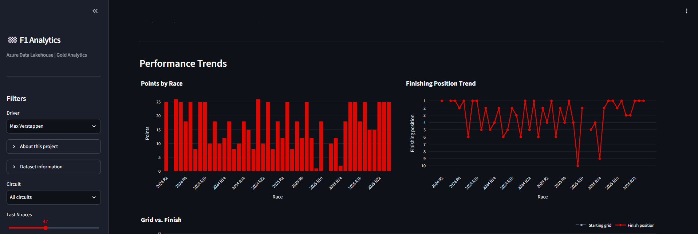
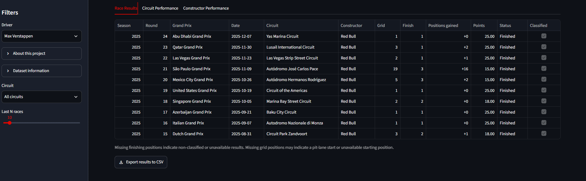
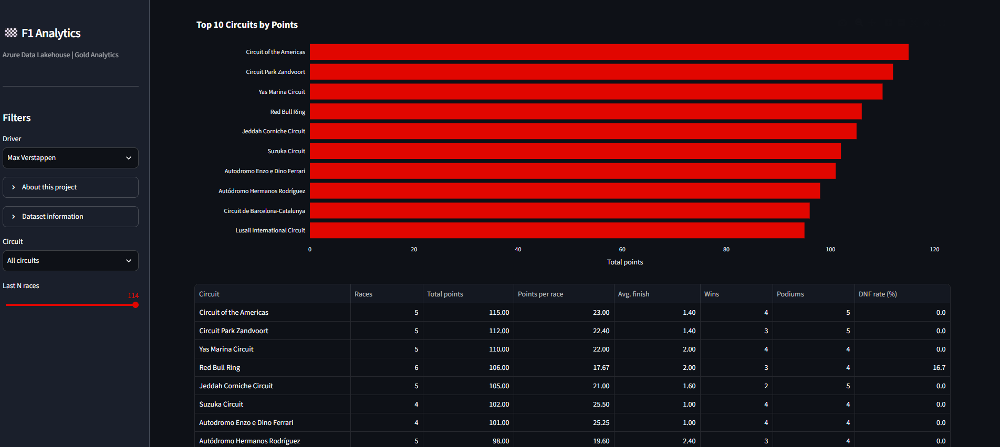
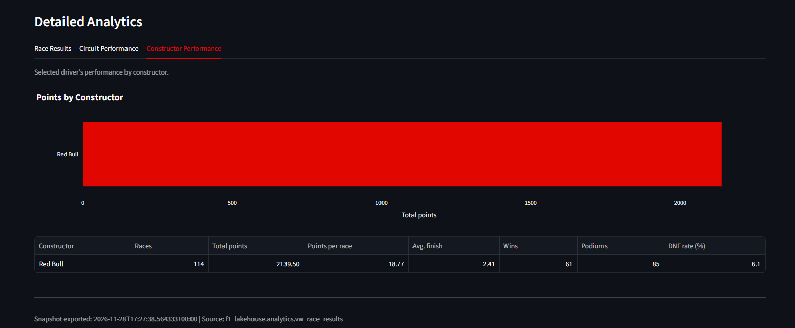
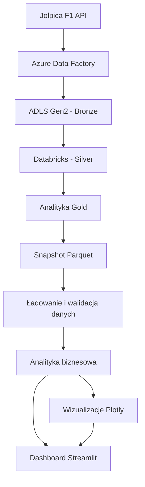

# Dashboard F1 Performance Analytics

[English](README.md) | [Polski](README.pl.md)

Interaktywny dashboard analityczny Formuły 1 zbudowany na podstawie warstwy Gold projektu Azure Data Lakehouse.

Dashboard demonstruje, w jaki sposób przygotowane zbiory analityczne mogą zostać przekształcone w interaktywny produkt danych bez konieczności bezpośredniego dostępu do infrastruktury chmurowej.

## Funkcjonalności

- Interaktywne filtrowanie kierowców i torów.
- Wybór liczby ostatnich wyścigów.
- Dynamiczne wskaźniki KPI.
- Wizualizacja punktów zdobywanych w wyścigach.
- Trendy pozycji końcowych.
- Porównanie pozycji startowej i końcowej.
- Szczegółowe wyniki wyścigów.
- Analiza wyników na torach.
- Analiza wyników w poszczególnych zespołach.
- Eksport przefiltrowanych danych do CSV.
- Informacje o aktualności zbioru danych.
- Obsługa pustych i nieklasyfikowanych wyników.

## Podgląd dashboardu

### Widok główny


### Trendy wyników



### Wyniki wyścigów



### Wyniki na torach



### Wyniki w zespołach



## Zbiór danych

| Właściwość | Wartość |
|---|---|
| Źródłowe API | Jolpica F1 API |
| Warstwa źródłowa | Gold |
| Widok źródłowy | `f1_lakehouse.analytics.vw_race_results` |
| Sezony historyczne | 2021–2025 |
| Początkowa liczba rekordów | 2 278 |
| Kolumny | 38 |
| Format danych | Apache Parquet |
| Kompresja | Snappy |
| Strategia odświeżania | Ręczny eksport snapshotu |

Dashboard wykorzystuje przygotowany snapshot Gold zapisany w repozytorium.

Uruchomienie aplikacji nie wymaga danych uwierzytelniających Azure ani aktywnych zasobów obliczeniowych Databricks.

## Architektura



## Technologie

- Python
- Streamlit
- Pandas
- Plotly
- Apache Parquet
- PyArrow
- Pytest

## Uruchomienie lokalne

Sklonuj repozytorium:

```bash
git clone https://github.com/mati290/f1-azure-data-lakehouse.git
cd f1-azure-data-lakehouse
```

Utwórz środowisko wirtualne:

```bash
python -m venv .venv
```

Aktywacja w systemie Windows:

```powershell
.venv\Scripts\Activate.ps1
```

Aktywacja w systemie Linux lub macOS:

```bash
source .venv/bin/activate
```

Zainstaluj zależności:

```bash
python -m pip install -r dashboard/requirements.txt
```

Uruchom aplikację z głównego katalogu repozytorium:

```bash
python -m streamlit run dashboard/app.py
```

Otwórz dashboard:

http://localhost:8501

## Struktura projektu

```text
dashboard/
├── app.py
├── analytics.py
├── charts.py
├── data_loader.py
├── styles.py
├── requirements.txt
├── README.md
├── README.pl.md
├── data/
│   ├── race_results.parquet
│   ├── metadata.json
│   └── README.md
└── tests/
    ├── conftest.py
    ├── test_analytics.py
    ├── test_data_loader.py
    └── test_charts.py
```

## Definicje metryk biznesowych

| Metryka | Definicja |
|---|---|
| Races | Liczba unikalnych wyścigów z zarejestrowanym wynikiem kierowcy |
| Total points | Suma punktów z wybranych wyścigów |
| Average finish | Średnia pozycja końcowa wyników klasyfikowanych |
| Wins | Liczba zwycięstw |
| Podiums | Liczba miejsc na podium |
| DNF rate | Udział wyników DNF w startach, wyrażony procentowo |
| Points per race | Suma punktów podzielona przez liczbę wybranych wyścigów |

Filtr ostatnich N wyścigów jest stosowany po filtrach kierowcy i toru.

Analiza konstruktorów przedstawia wyniki wybranego kierowcy w poszczególnych zespołach, a nie wyniki całego zespołu.

Nieklasyfikowane pozycje końcowe są wykluczane z obliczeń średniej pozycji końcowej i prezentowane jako brakujące wartości na wykresach pozycji.

## Testowanie

Dashboard zawiera 36 testów automatycznych obejmujących:

- Ładowanie danych i walidację schematu.
- Unikalność kluczy biznesowych.
- Spójność metadanych snapshotu.
- Filtrowanie kierowców i torów.
- Obliczanie KPI.
- Obsługę pustych wyników.
- Agregacje według torów i konstruktorów.
- Generowanie wykresów Plotly.

Uruchomienie testów dashboardu:

```bash
python -m pip install pytest
python -m pytest dashboard/tests -v
```

## Ograniczenia

- Dashboard wykorzystuje statyczny snapshot historyczny zamiast danych na żywo.
- Aktualny snapshot obejmuje sezony 2021–2025.
- Aktualizacja snapshotu wymaga ponownego eksportu warstwy analitycznej Gold.
- Brakujące i nieklasyfikowane wyniki są obsługiwane zgodnie z modelem danych Gold.
- Interfejs aplikacji pozostaje anglojęzyczny.

## Źródło danych

Historyczne dane Formuły 1 pochodzą z Jolpica F1 API:

https://github.com/jolpica/jolpica-f1

Dodatkowe informacje o źródle i licencji znajdują się w [dokumentacji zbioru danych](data/README.md).

Jest to nieoficjalny, niekomercyjny projekt edukacyjny Data Engineering, niezwiązany oficjalnie z Formułą 1.

## Powiązana dokumentacja

- [Architektura rozwiązania](../docs/pl/architecture.md)
- [Konfiguracja i odtwarzalność](../docs/pl/setup.md)
- [Analityka biznesowa SQL](../docs/pl/sql_business_analytics.md)
- [Jakość danych i CI](../docs/pl/data_quality_and_ci.md)
- [Demonstracja portfolio](../docs/pl/portfolio_demo.md)