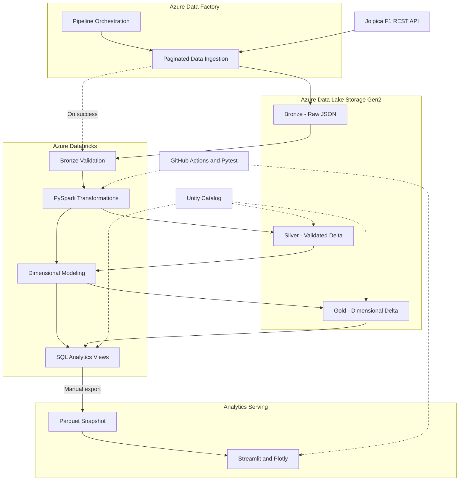
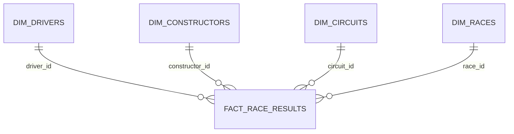
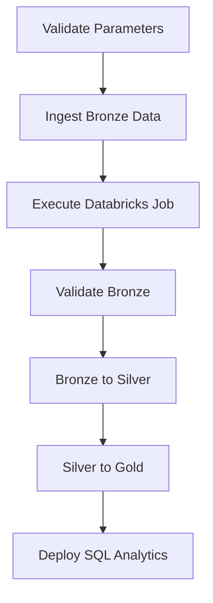

# Solution Architecture

[English](architecture.md) | [Polski](pl/architecture.md)

## 1. Overview

F1 Performance Analytics is an end-to-end batch data engineering solution built using the Azure ecosystem.

The platform ingests historical Formula 1 race results, transforms and validates the data, builds a dimensional model and delivers interactive performance analytics.

The solution follows the Medallion Architecture with Bronze, Silver and Gold layers.

## 2. High-Level Architecture

## 3. Architecture Components

| Component | Responsibility |
|---|---|
| Jolpica F1 API | Historical Formula 1 race results |
| Azure Data Factory | Data ingestion and pipeline orchestration |
| ADLS Gen2 | Persistent storage for Bronze, Silver and Gold data |
| Azure Databricks | Data validation and transformation |
| PySpark | Distributed data processing |
| Delta Lake | Transactional analytical tables |
| Unity Catalog | Data organization and access governance |
| Databricks SQL | Business-oriented analytical views |
| Apache Parquet | Portable analytical snapshot |
| Streamlit | Interactive analytics dashboard |
| Plotly | Interactive data visualization |
| GitHub Actions | Continuous integration |
| Pytest | Automated testing |

## 4. Medallion Architecture

### Bronze Layer

The Bronze layer stores original JSON responses from the source API.

- Offset-based pagination.
- Fixed page size of 100 records.
- Storage organized by season and pagination offset.
- Deterministic filenames.
- Raw source data preservation.
- Metadata and completeness validation.

### Silver Layer

The Silver layer provides structured and validated race results.

- Explicit schema enforcement.
- Nested JSON flattening.
- Data type conversion.
- Duplicate detection.
- Business rule validation.
- Derived performance metrics.
- Delta Lake storage.

Target table: `f1_lakehouse.silver.race_results`

### Gold Layer

The Gold layer provides a business-oriented dimensional model.

- Four dimension tables.
- One central fact table.
- Star Schema architecture.
- Logical primary and foreign key validation.
- Analytical SQL views.
- Record count and points reconciliation.

## 5. Dimensional Data Model

### Data Grain

| Table | Grain | Initial records |
|---|---|---:|
| dim_drivers | One driver | 35 |
| dim_constructors | One constructor | 12 |
| dim_circuits | One circuit | 28 |
| dim_races | One race | 114 |
| fact_race_results | One driver result per race | 2,278 |

The Silver business key consists of `season`, `round` and `driver_id`.

The Gold fact table uses the composite key `race_id` and `driver_id`.

These counts represent the validated historical dataset covering seasons 2021–2025.

## 6. Pipeline Orchestration

The main Azure Data Factory pipeline is `pl_f1_end_to_end`.

The pipeline supports two execution modes:

- Full historical load.
- Selected season refresh.

A selected season refresh updates Bronze data for the requested season while rebuilding Silver and Gold from the complete historical Bronze dataset.

Dependent processing stages execute only after successful upstream activities.

## 7. Analytics Serving Layer

The Gold analytics schema provides six SQL views:

- `vw_race_results`
- `vw_driver_circuit_history`
- `vw_driver_circuit_performance`
- `vw_driver_positions_gained`
- `vw_driver_season_performance`
- `vw_constructor_circuit_performance`

The Streamlit dashboard uses a Parquet snapshot exported from:

`f1_lakehouse.analytics.vw_race_results`

The initial snapshot contains 2,278 records and 38 columns.

Snapshot export is a separate manual operation and is not part of the main orchestration pipeline.

This design allows the dashboard to run without Azure credentials or active cloud compute resources.

## 8. Data Quality and Reliability

Data quality controls are implemented across the processing layers.

- API pagination and record completeness.
- Schema validation.
- Business key uniqueness.
- Numeric value validation.
- Referential integrity.
- Race points reconciliation.
- Delta read-back validation.
- Automated unit tests.
- Content-level idempotency validation.

Validation failures stop dependent processing stages.

Cross-table transactional rollback is not implemented.

## 9. Architecture Decisions

| Decision | Rationale |
|---|---|
| Batch processing | Appropriate for historical race data |
| Medallion Architecture | Separation of raw, validated and analytical data |
| Full refresh transformations | Simplicity for the current dataset size |
| Delta Lake | Transactional writes and version history |
| Star Schema | Business-oriented SQL analytics |
| Natural business keys | Traceability to source identifiers |
| Type 1 dimensions | Simplified dimension management |
| Serverless compute | Avoid persistent compute resources |
| Managed Identity | Reduce credential management |
| Parquet snapshot | Portable dashboard without cloud access |
| Manual execution | Control development costs |

## 10. Scope and Limitations

The MVP covers historical Grand Prix race results from 2021 to 2025.

The solution does not implement real-time streaming, incremental Silver and Gold processing, historical dimension versions, automated infrastructure deployment or cross-table transactional rollback.

Sprint results, qualifying results, lap-level telemetry and pit stop analysis are outside the current MVP scope.

## 11. Related Documentation

- [Azure Setup](azure_setup.md)
- [Data Source](data_source.md)
- [Bronze Ingestion](bronze_ingestion.md)
- [Silver Transformations](silver_transformations.md)
- [Gold Dimensional Model](gold_dimensional_model.md)
- [SQL Business Analytics](sql_business_analytics.md)
- [End-to-End Pipeline](end_to_end_pipeline.md)
- [Data Quality and CI](data_quality_and_ci.md)
- [Streamlit Dashboard](../dashboard/README.md)
- [Main README](../README.md)