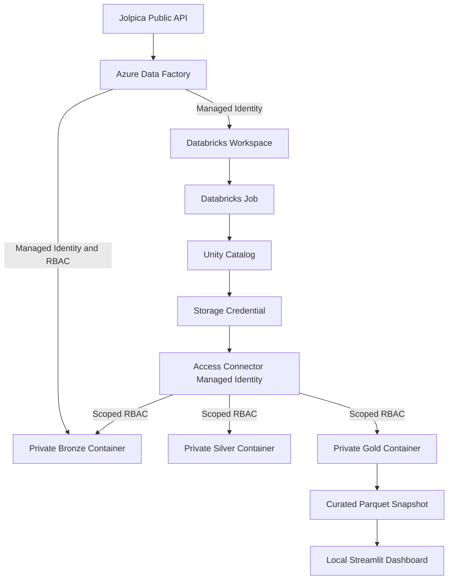

# Costs, Security and Technical Trade-offs

[English](costs_security_tradeoffs.md) | [Polski](pl/costs_security_tradeoffs.md)

## 1. Overview

The F1 Azure Data Lakehouse is an educational Data Engineering portfolio project designed to balance cloud architecture, security, reproducibility, development costs and implementation complexity.

The MVP intentionally avoids unnecessary production infrastructure.

## 2. Azure Infrastructure

| Resource | Configuration | Region |
|---|---|---|
| Subscription | Azure for Students | N/A |
| Resource Group | Development environment | West Europe |
| ADLS Gen2 | Standard LRS, Hot tier | West Europe |
| Azure Data Factory | V2 | Poland Central |
| Azure Databricks | Premium, Serverless compute | Germany West Central |
| Databricks Access Connector | Managed Identity | West Europe |

The regional configuration reflects service availability during project development.

West Europe was unavailable for new Databricks workspace creation. Germany West Central was selected as an alternative.

The Databricks trial pricing tier was not supported by the Azure for Students subscription.

## 3. Cost Management

### 3.1. Budget Configuration

| Property | Value |
|---|---|
| Monthly budget | 10 USD or equivalent billing currency |
| First alert | 50% |
| Second alert | 80% |
| Third alert | 100% |
| Pipeline schedule | Not configured |
| Execution strategy | Manual |

Azure budget alerts provide spending notifications but do not automatically stop resource consumption.

The configured budget is a monitoring threshold, not a guaranteed spending limit.

### 3.2. Cost Drivers

| Component | Potential cost drivers |
|---|---|
| Azure Data Factory | Activity execution, orchestration and data movement |
| ADLS Gen2 | Stored data, transactions and data transfer |
| Azure Databricks | Serverless compute consumption |
| Cross-region architecture | Inter-region data transfer |
| GitHub Actions | Runner usage subject to account allowances |
| Local dashboard | No additional Azure compute consumption |

Actual costs depend on resource configuration, usage, region and applicable pricing.

Detailed billing records were not collected as part of this documentation. No verified total project cost or cost per execution is claimed.

### 3.3. Cost Optimization Decisions

- Use Serverless compute instead of persistent Spark clusters.
- Execute cloud workloads manually.
- Avoid unnecessary recurring schedules.
- Use Standard LRS storage for the development environment.
- Refresh selected historical seasons when appropriate.
- Limit unnecessary automatic retries.
- Run automated unit tests outside Azure.
- Serve the dashboard using a local Parquet snapshot.
- Monitor Azure spending using budget alerts.

Serverless compute reduces the need to manage persistent clusters but does not guarantee lower costs for every workload.

## 4. Observed Performance Improvement

The end-to-end execution tests were performed on November 27, 2026.

| Processing stage | Full historical load | Selected season refresh | Time reduction |
|---|---|---|---:|
| Bronze ingestion | 11m 53s | 2m 23s | 79.9% |
| Databricks Job activity | 4m 44s | 4m 30s | 4.9% |
| Total execution | 16m 37s | 6m 53s | 58.6% |

The selected season refresh reduced observed execution time by approximately 9 minutes and 44 seconds.

The largest improvement occurred in Bronze ingestion because only one season was downloaded instead of five.

Silver and Gold transformations continued to process the complete historical dataset.

These measurements represent individual test executions rather than a statistical performance benchmark.

Execution time reduction should not be interpreted as an equivalent reduction in Azure billing costs.

## 5. Security Architecture

## 6. Identity and Access Management

### 6.1. Azure Data Factory

Azure Data Factory uses a system-assigned Managed Identity.

Storage access is granted through the Storage Blob Data Contributor role scoped to the Bronze container.

The ingestion identity does not require unrestricted access to the Silver and Gold containers.

### 6.2. Databricks Access Connector

The Databricks Access Connector uses Managed Identity authentication.

| Permission | Scope |
|---|---|
| Storage Blob Delegator | Storage account |
| Storage Blob Data Contributor | Bronze container |
| Storage Blob Data Contributor | Silver container |
| Storage Blob Data Contributor | Gold container |

Bronze write access is restricted at the Unity Catalog external location level.

The underlying Azure RBAC role still permits write operations. The Unity Catalog read-only configuration should not be interpreted as an Azure storage-level deny policy.

### 6.3. Unity Catalog

| External location | Access mode |
|---|---|
| loc_f1_bronze | Read only |
| loc_f1_silver | Read and write |
| loc_f1_gold | Read and write |

Storage access is managed through Unity Catalog storage credentials and external locations.

### 6.4. ADF-to-Databricks Integration

The ADF Managed Identity is registered in the Databricks workspace as a Microsoft Entra ID managed service principal.

| Scope | Permission |
|---|---|
| Azure Databricks resource | Contributor |
| Databricks workspace | Workspace access |
| Databricks Job | Can Manage Run |

The Azure Contributor role is scoped to the Databricks workspace resource.

The Databricks Job runs under the configured workspace user identity.

A dedicated service principal for Job execution would provide improved identity separation in a production environment.

## 7. Data Protection and Privacy

The project processes publicly available historical Formula 1 race results.

The dataset includes public driver information such as names, nationalities and racing performance.

Public availability does not remove all privacy or licensing obligations.

Implemented storage security measures include:

- Private storage containers.
- Anonymous access disabled.
- Secure transfer enabled.
- Managed Identity authentication.
- Scoped Azure RBAC permissions.
- Unity Catalog access governance.

The published dashboard snapshot contains curated racing data rather than Azure authentication credentials.

The project is intended for educational and non-commercial portfolio demonstration purposes.

Data attribution and licensing information is documented in [Dashboard Dataset](../dashboard/data/README.md).

## 8. Secrets Management

The project uses Managed Identity instead of hardcoded storage account keys or personal access tokens for its cloud integrations.

Repository configuration should not contain:

- Passwords.
- Personal access tokens.
- Client secrets.
- Storage account keys.
- SAS tokens.
- Sensitive connection strings.

Environment-specific configuration templates must be reviewed before publication.

Resource names and identifiers are not necessarily authentication secrets, but unnecessary infrastructure details should be minimized in public documentation.

A final repository and Git history security audit is required before the MVP release.

## 9. Network Security

The development environment uses public service endpoints to reduce infrastructure complexity.

Public endpoints do not imply anonymous access to storage data.

The MVP does not implement a fully isolated private network architecture.

Production improvements could include:

- Private endpoints.
- Restricted network access.
- Dedicated execution identities.
- Centralized security monitoring.
- Periodic access reviews.
- Automated secret scanning.

## 10. Technical Decisions and Trade-offs

| Decision | Benefit | Trade-off |
|---|---|---|
| Azure Data Factory | Managed ingestion and orchestration | Azure-specific configuration |
| Databricks Serverless | Reduced compute administration | Usage-based costs and regional availability |
| Medallion Architecture | Separation of processing stages | Additional storage and processing layers |
| Delta Lake | Transactional table writes and version history | Additional metadata and storage maintenance |
| Full-refresh transformations | Simple and predictable processing | Reprocesses unchanged historical data |
| Sequential ingestion | Easier troubleshooting and control | Longer execution for larger datasets |
| Star Schema | Clear analytical model | Additional joins and dimension management |
| Natural business keys | Traceability to source data | Dependency on source identifier stability |
| Type 1 dimensions | Simple dimension updates | No historical attribute versions |
| Standard SQL views | Reusable business logic | Query-time computation |
| Local Parquet snapshot | Portable and inexpensive demonstration | Manual refresh and no live cloud connection |
| Manual orchestration | Controlled development spending | No automated data freshness guarantee |
| GitHub Actions CI | Regression protection without Azure | No full cloud integration testing |
| Manual infrastructure setup | Reduced MVP implementation effort | Environment-specific deployment steps |
| Standard LRS storage | Lower development complexity and cost | Limited redundancy compared with geo-redundant options |

## 11. Reliability and Failure Handling

The orchestration pipeline validates input parameters before ingestion.

Dependent activities execute only after successful upstream processing.

The Databricks Job is configured with one maximum concurrent run and queueing enabled.

The project includes:

- API and ingestion retry policies.
- Notebook-level data quality validation.
- Business key validation.
- Referential integrity checks.
- Record count and points reconciliation.
- Delta content-level idempotency validation.
- Automated unit tests.

Delta Lake provides transactional guarantees at the individual table level.

Cross-table transactional rollback is not implemented.

Concurrent ADF pipeline execution has not been fully tested.

## 12. Known Limitations

- Historical scope limited to 2021–2025.
- Grand Prix results only.
- No real-time streaming.
- No incremental Silver and Gold transformations.
- No historical dimension versions.
- Manual dashboard snapshot refresh.
- No automated infrastructure provisioning.
- No full cloud integration testing in CI.
- No comprehensive production monitoring.
- No fully isolated private network architecture.
- No verified execution-level cost benchmark.

## 13. Production Considerations

A production implementation should evaluate workload scale, data freshness requirements, recovery objectives, security policies and operational budgets.

Potential improvements include incremental processing, stronger identity separation, network isolation, automated deployment, enhanced observability and workload-level cost attribution.

These improvements remain outside the current MVP scope.

## 14. Related Documentation

- [Solution Architecture](architecture.md)
- [Azure Environment Setup](azure_setup.md)
- [Setup and Reproducibility](setup.md)
- [End-to-End Pipeline](end_to_end_pipeline.md)
- [Data Quality and CI](data_quality_and_ci.md)
- [Portfolio Demo](portfolio_demo.md)
- [Dashboard Dataset](../dashboard/data/README.md)