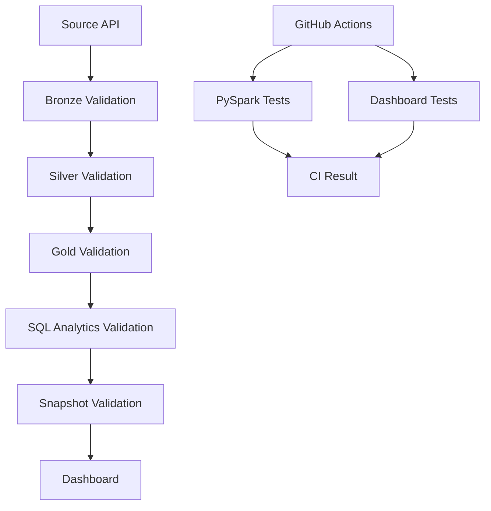
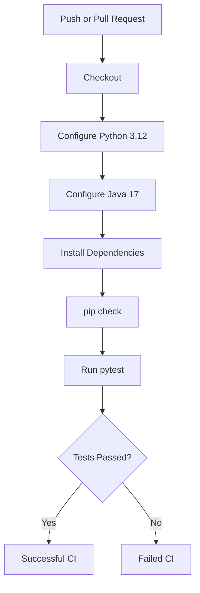

# Data Quality and CI

[English](data_quality_and_ci.md) | [Polski](pl/data_quality_and_ci.md)

## 1. Overview

The F1 Azure Data Lakehouse implements data quality controls across ingestion, transformation, dimensional modeling, analytics and dashboard serving.

Automated tests and continuous integration protect reusable business logic against regressions.

Cloud integration validation is performed separately in Azure Databricks.

## 2. Data Quality Architecture



## 3. Validation by Layer

| Layer | Validation |
|---|---|
| Bronze | Pagination, metadata, season coverage and completeness |
| Silver | Schema, business keys, points and derived metrics |
| Gold | Primary keys, foreign keys and record reconciliation |
| Analytics | View availability, rankings and business metric consistency |
| Snapshot | Schema, metadata, record count and business keys |
| Dashboard | Filters, KPIs, aggregations and chart generation |

Notebook-level validation failures stop dependent processing stages.

SQL validation queries require manual inspection where automatic failure enforcement is not implemented.

## 4. Reusable Transformation Logic

| Function | Responsibility |
|---|---|
| cast_race_results() | Convert values into appropriate Spark data types |
| normalize_strings() | Trim strings and convert empty strings to NULL |
| deduplicate_records() | Remove exact duplicate records |

Implementation:

- `src/transformations.py`
- `src/data_quality.py`

Conflicting records sharing the same business key are rejected rather than silently removed.

Invalid records detected by shared validation functions raise `DataQualityError`.

## 5. Business Rules

| Rule | Expected behavior |
|---|---|
| Business key uniqueness | Reject duplicate keys |
| Business key completeness | Reject NULL key values |
| Points completeness | Reject NULL points |
| Non-negative points | Reject negative points |
| Fractional points | Preserve valid decimal values |
| Exact duplicates | Remove identical records |
| Non-classified finish | Preserve missing finishing position |
| Positions gained | Require a valid grid and classified finish |
| Referential integrity | Reject unmatched dimension keys |

Silver business key:

`season + round + driver_id`

Gold fact business key:

`race_id + driver_id`

Primary and foreign keys are logical constraints validated by the processing code.

## 6. Automated Test Coverage

The combined MVP test suite contains 57 tests.

| Test suite | Tests |
|---|---:|
| PySpark transformations and data quality | 21 |
| Dashboard analytics, loading and charts | 36 |
| Total | 57 |

The combined suite passed during local MVP development.

### PySpark Tests

| Category | Tests |
|---|---:|
| Data type conversion | 5 |
| String normalization | 4 |
| Deduplication | 3 |
| Data quality validation | 9 |
| Total | 21 |

### Dashboard Tests

Coverage includes:

- Snapshot loading.
- Required schema validation.
- Metadata consistency.
- Business key validation.
- Driver and circuit filters.
- Last N race selection.
- KPI calculations.
- Empty result handling.
- Non-classified results.
- Circuit and constructor aggregations.
- Plotly chart generation.

## 7. Test Structure

```text
tests/
├── conftest.py
├── test_transformations.py
└── test_data_quality.py

dashboard/tests/
├── conftest.py
├── test_analytics.py
├── test_data_loader.py
└── test_charts.py
```

The tests use controlled fixtures and do not require live Azure services.

## 8. Running Tests Locally

Prerequisites:

- Python 3.12
- Java 17
- Python virtual environment

Install dependencies:

```bash
python -m pip install -r requirements-dev.txt
python -m pip install -r dashboard/requirements.txt
```

Check dependency consistency:

```bash
python -m pip check
```

Run the complete test suite:

```bash
python -m pytest -q
```

Expected MVP baseline:

```text
57 passed
```

Run individual test suites:

```bash
python -m pytest tests -v
python -m pytest dashboard/tests -v
```

A Pandas compatibility warning was observed during local PySpark testing. Dependency compatibility should be reviewed before expanding Pandas-dependent Spark operations.

## 9. CI

Workflow:

`.github/workflows/ci.yml`

The workflow executes automatically on:

- Pushes to main.
- Pushes to feature branches.
- Pull requests targeting main.



The GitHub-hosted Ubuntu runner installs both development and dashboard dependencies.

The pytest configuration discovers tests in `tests/` and `dashboard/tests/`.

The workflow uses read-only repository permissions and does not deploy cloud infrastructure.

## 10. Cloud Integration Validation

The original validated historical dataset produced the following results.

| Metric | Value |
|---|---:|
| Bronze JSON files | 25 |
| Silver records | 2,278 |
| Gold fact records | 2,278 |
| Classified results | 2,007 |
| DNF | 288 |
| DNS | 14 |
| DSQ | 11 |
| Wins | 114 |
| Podiums | 342 |
| Duplicate business keys | 0 |
| Orphan foreign keys | 0 |
| Analytical views | 6 |

DNF and classification flags are not mutually exclusive.

### Points Reconciliation

| Layer | Total race points |
|---|---:|
| Silver | 11,540.50 |
| Gold | 11,540.50 |
| Analytics | 11,540.50 |

The reconciliation covers Grand Prix race points only.

## 11. Idempotency

Silver and Gold transformations use Delta overwrite mode.

Content-level idempotency was validated for the historical dataset using Delta Lake Time Travel.

Validation included:

- Schema comparison.
- Record count comparison.
- Business key uniqueness.
- Bidirectional exceptAll comparison.

Repeated processing of unchanged historical input produced equivalent table contents in the tested execution sequence.

This does not guarantee idempotency for every future source change or concurrent execution scenario.

## 12. End-to-End Validation

| Scenario | Documented result |
|---|---|
| Full historical load | PASS |
| Selected season refresh | PASS |
| Invalid parameter rejection | PASS |
| Record count validation | PASS |
| Business key uniqueness | PASS |
| Delta content consistency | PASS |
| Bronze storage validation | PASS |
| Analytics view validation | PASS |
| Points reconciliation | PASS |

See [End-to-End Pipeline](end_to_end_pipeline.md) for execution evidence.

## 13. Security and Cost

- No Azure credentials required for local tests.
- No live cloud resources required for CI.
- Read-only GitHub Actions permissions.
- Controlled test fixtures.
- Manual cloud integration testing.
- No automated infrastructure deployment.

## 14. Limitations

- CI does not execute the full Azure pipeline.
- Not all SQL validation queries automatically fail execution.
- Cross-table transactional rollback is not implemented.
- Concurrent pipeline execution has not been fully tested.
- Automated coverage reporting is outside the current MVP.
- Pandas compatibility requires continued monitoring.

## 15. Future Improvements

- Automated SQL assertion enforcement.
- Additional malformed input scenarios.
- Expanded dimensional model tests.
- Automated test coverage reporting.
- Dependency compatibility checks.
- Controlled deployment automation.

## 16. Related Documentation

- [Solution Architecture](architecture.md)
- [SQL Business Analytics](sql_business_analytics.md)
- [End-to-End Pipeline](end_to_end_pipeline.md)
- [Setup and Reproducibility](setup.md)
- [Dashboard Documentation](../dashboard/README.md)