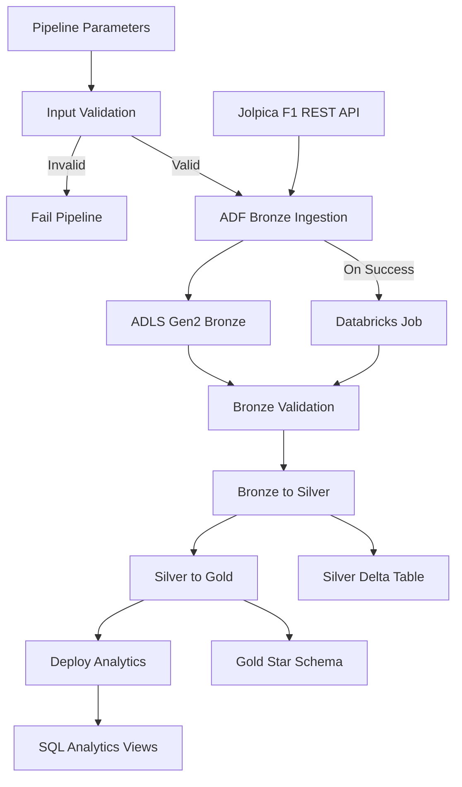
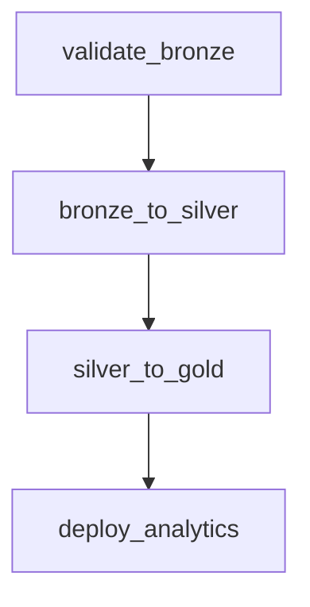
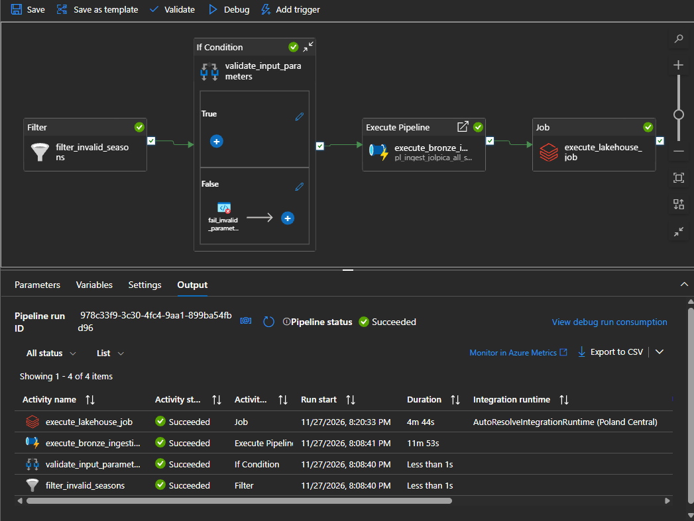
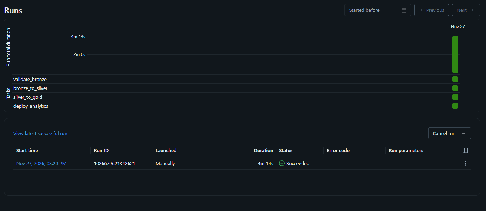
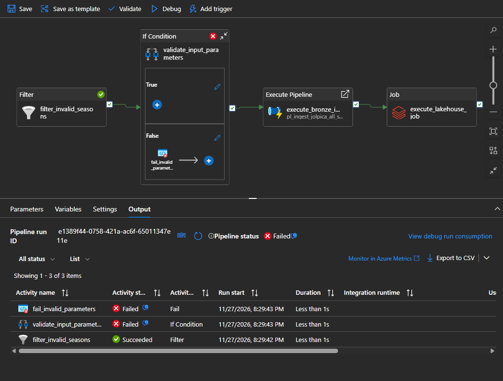
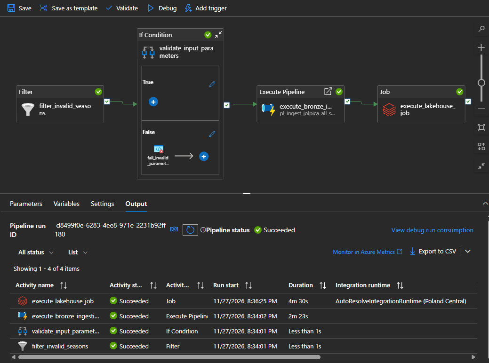

# End-to-End Pipeline Orchestration

## 1. Overview

The end-to-end pipeline orchestrates the complete F1
lakehouse data processing workflow, from historical race
results ingestion to analytical SQL views.

Azure Data Factory acts as the main orchestration layer,
while Azure Databricks manages data validation,
transformation, dimensional modeling and analytics.

The pipeline supports two execution modes:

- Full historical load.
- Selected season refresh.

The MVP covers Formula 1 race results from 2021 to 2025.

## 2. Architecture



### Technology Stack

| Component | Technology |
|---|---|
| Data source | Jolpica F1 REST API |
| Main orchestration | Azure Data Factory |
| Transformation orchestration | Databricks Jobs |
| Compute | Databricks Serverless |
| Storage | Azure Data Lake Storage Gen2 |
| Processing | Python and PySpark |
| Table format | Delta Lake |
| Governance | Unity Catalog |
| Analytics | Databricks SQL |
| Authentication | Managed Identity |
| Version control | Git and GitHub |

## 3. Azure Data Factory Configuration

### Main Pipeline

| Property | Value |
|---|---|
| Pipeline name | pl_f1_end_to_end |
| Linked service | ls_databricks_f1 |
| Integration runtime | AutoResolveIntegrationRuntime |
| Authentication | System Assigned Managed Identity |
| Execution | Manual |
| Schedule | Not configured |

### Pipeline Activities

| Activity | Type | Responsibility |
|---|---|---|
| filter_invalid_seasons | Filter | Identify unsupported seasons |
| validate_input_parameters | If Condition | Validate input parameters |
| fail_invalid_parameters | Fail | Reject invalid parameters |
| execute_bronze_ingestion | Execute Pipeline | Run historical data ingestion |
| execute_lakehouse_job | Databricks Job | Execute lakehouse processing |

All main activities use success-based dependencies.

The Databricks Job is executed only after successful
input validation and Bronze ingestion.

## 4. Pipeline Parameters

| Parameter | Type | Default value |
|---|---|---|
| seasons | Array | ["2021","2022","2023","2024","2025"] |

The API pagination limit is fixed at 100 records per page.

This ensures consistency with the existing Bronze
storage structure.

### Full Historical Load

```json
["2021", "2022", "2023", "2024", "2025"]
```

Downloads all supported historical seasons and rebuilds
the Silver and Gold layers.

### Selected Season Refresh

```json
["2025"]
```

Downloads only the selected season while rebuilding
Silver and Gold from the complete Bronze dataset.

Selected season refresh requires the remaining historical
seasons to already exist in Bronze storage.

The transformation layers use a full-refresh strategy
rather than incremental processing.

## 5. Input Validation

The pipeline validates the following conditions:

- The seasons array must not be empty.
- Every season must belong to the supported MVP range.
- Duplicate season values are not allowed.

Invalid input terminates execution with the following
error code:

```text
INVALID_PARAMETERS
```

Error message:

```text
Seasons must be a non-empty array of unique values
between 2021 and 2025.
```

Invalid parameters prevent both Bronze ingestion and
Databricks processing from starting.

## 6. Databricks Job Configuration

| Property | Value |
|---|---|
| Job name | job_f1_lakehouse |
| Compute | Serverless |
| Maximum concurrent runs | 1 |
| Queue | Enabled |
| Performance target | Performance optimized |
| Schedule | Not configured |

### Job Tasks

| Task | Notebook | Dependency |
|---|---|---|
| validate_bronze | 01_bronze_validation | None |
| bronze_to_silver | 02_bronze_to_silver | validate_bronze |
| silver_to_gold | 03_silver_to_gold | bronze_to_silver |
| deploy_analytics | 04_sql_business_analytics | silver_to_gold |

### Task Dependencies



All dependent tasks use the ALL_SUCCESS execution
condition.

A failed upstream task prevents dependent tasks from
starting.

The Job configuration template is stored in:

`databricks/jobs/job_f1_lakehouse.json`

## 7. Authentication and Security

Azure Data Factory uses its System Assigned Managed
Identity to authenticate with Azure Databricks.

The Managed Identity is registered as a Microsoft Entra
ID managed service principal in the Databricks workspace.

### Permissions

| Scope | Permission |
|---|---|
| Azure Databricks resource | Contributor |
| Databricks workspace | Workspace access |
| Databricks Job | Can Manage Run |

The Contributor role is scoped to the Databricks
workspace resource rather than the entire subscription
or resource group.

The ADF identity does not require Databricks administrator
permissions or unrestricted cluster creation.

The Job runs under the configured workspace user
identity.

Access to ADLS Gen2 is managed through Unity Catalog
storage credentials and external locations.

No personal access tokens, passwords or client secrets
are required for the ADF-to-Databricks integration.

For production environments, a dedicated service
principal should also be considered for the Job
execution identity.

## 8. Error Handling

The pipeline uses native Azure Data Factory and
Databricks failure propagation.

| Failure scenario | Expected behavior |
|---|---|
| Invalid input parameters | Pipeline terminates before ingestion |
| Bronze ingestion failure | Databricks Job does not start |
| Bronze validation failure | Silver and subsequent tasks do not start |
| Silver transformation failure | Gold and Analytics do not start |
| Gold transformation failure | Analytics does not start |
| SQL execution failure | Databricks Job reports failure |

The Bronze ingestion pipelines include retry policies
for API requests and Copy activities.

The Databricks Job activity in ADF uses zero automatic
retries to avoid unnecessary repeated processing.

Pipeline and task execution details are available
through Azure Data Factory Monitor and Databricks
Job Runs.

Failure propagation does not provide transactional
rollback across all lakehouse tables.

## 9. End-to-End Execution Results

Testing was performed on November 27, 2026.

### Full Historical Load

Input:

```json
["2021", "2022", "2023", "2024", "2025"]
```

Result: **PASSED**

| Metric | Result |
|---|---|
| ADF pipeline status | Succeeded |
| ADF main activities | 4/4 succeeded |
| Databricks Job status | Succeeded |
| Databricks tasks | 4/4 succeeded |
| Bronze ingestion duration | 11m 53s |
| Databricks Job activity duration | 4m 44s |
| Databricks Job duration | 4m 14s |
| Approximate total duration | 16m 37s |

### Azure Data Factory Execution



### Databricks Job Execution



### Negative Parameter Test

Input:

```json
["2026"]
```

Result: **PASSED**

The unsupported season was rejected by the input
validation logic.

Bronze ingestion and Databricks processing were not
started.



### Selected Season Refresh

Input:

```json
["2025"]
```

Result: **PASSED**

| Metric | Result |
|---|---|
| ADF pipeline status | Succeeded |
| Bronze ingestion duration | 2m 23s |
| Databricks Job activity duration | 4m 30s |
| Approximate total duration | 6m 53s |



## 10. Performance Comparison

| Processing stage | Full load | Season refresh | Time reduction |
|---|---|---|---|
| Bronze ingestion | 11m 53s | 2m 23s | 79.9% |
| Databricks Job activity | 4m 44s | 4m 30s | 4.9% |
| Total | 16m 37s | 6m 53s | 58.6% |

Selected season refresh reduced the observed execution
time by approximately 9 minutes and 44 seconds.

The largest improvement occurred in the ingestion layer,
where only one season was downloaded instead of five.

Transformation duration remained similar because the
Silver and Gold layers still process the complete
historical dataset.

These measurements represent individual test executions,
not a statistical performance benchmark.

## 11. Data Quality Validation

The post-execution validation notebook is stored in:

`notebooks/05_end_to_end_validation.py`

### Record Counts

| Table | Expected | Actual | Result |
|---|---:|---:|---|
| silver.race_results | 2278 | 2278 | PASS |
| gold.dim_drivers | 35 | 35 | PASS |
| gold.dim_constructors | 12 | 12 | PASS |
| gold.dim_circuits | 28 | 28 | PASS |
| gold.dim_races | 114 | 114 | PASS |
| gold.fact_race_results | 2278 | 2278 | PASS |

### Business Key Validation

All six Silver and Gold tables were checked for
duplicate business keys.

Result: **PASS**

Duplicate business keys detected: **0**

### Bronze Storage Validation

| Season | JSON files |
|---|---:|
| 2021 | 5 |
| 2022 | 5 |
| 2023 | 5 |
| 2024 | 5 |
| 2025 | 5 |
| Total | 25 |

Result: **PASS**

### Analytics Validation

All six analytical views were successfully queried
and returned non-empty results.

- vw_race_results
- vw_driver_circuit_history
- vw_driver_circuit_performance
- vw_driver_positions_gained
- vw_driver_season_performance
- vw_constructor_circuit_performance

Result: **PASS**

### Points Reconciliation

| Layer | Total race points |
|---|---:|
| Silver | 11540.50 |
| Gold | 11540.50 |
| Analytics | 11540.50 |

Result: **PASS**

The reconciliation covers race result points only.
Sprint race points are outside the current MVP scope.

## 12. Idempotency Validation

Delta Lake Time Travel was used to compare the two
latest WRITE versions of each Silver and Gold table.

Validation included:

- Schema data type comparison.
- Record count validation.
- Business key uniqueness.
- Bidirectional exceptAll content comparison.

### Delta Version Comparison

| Table | Previous version | Current version | Result |
|---|---:|---:|---|
| silver.race_results | 1 | 2 | PASS |
| gold.dim_drivers | 2 | 3 | PASS |
| gold.dim_constructors | 2 | 3 | PASS |
| gold.dim_circuits | 2 | 3 | PASS |
| gold.dim_races | 2 | 3 | PASS |
| gold.fact_race_results | 2 | 3 | PASS |

All six tables contained identical data across the
compared versions.

The tested refresh execution did not introduce
duplicate records or unexpected content changes.

This demonstrates content-level idempotency for the
tested historical dataset and execution sequence.

## 13. Deployment and Version Control

Azure Data Factory resources are version-controlled
through GitHub integration.

Relevant configuration files:

```text
adf/
├── linkedService/
│   └── ls_databricks_f1.json
└── pipeline/
    └── pl_f1_end_to_end.json

databricks/
└── jobs/
    └── job_f1_lakehouse.json

notebooks/
└── 05_end_to_end_validation.py
```

The Databricks Job JSON is a sanitized configuration
template.

Before deployment to another environment:

1. Configure Azure resources and Unity Catalog.
2. Import the required notebooks into Databricks.
3. Replace the WORKSPACE_NOTEBOOK_ROOT placeholder.
4. Create the Databricks Job.
5. Configure the execution identity.
6. Grant the ADF Managed Identity Job permissions.
7. Update the Job ID in the ADF activity.
8. Configure environment-specific linked services.
9. Validate and publish the ADF configuration.
10. Execute the full historical load.

Automated infrastructure deployment is outside the
current MVP scope.

## 14. Cost Management

The project uses manual pipeline execution rather than
a recurring production schedule.

Cost management decisions include:

- Serverless compute instead of persistent clusters.
- No continuously running ingestion services.
- Selected season refresh to reduce ingestion work.
- Limited automatic retries.
- Sequential Databricks Job execution.
- Azure budget monitoring.

Actual execution costs depend on Azure pricing,
Databricks usage and resource configuration.

## 15. Limitations

The current implementation intentionally prioritizes
simplicity and reproducibility.

Known limitations:

- Historical data scope is limited to 2021-2025.
- Selected season refresh is not incremental
  transformation processing.
- Bronze ingestion is sequential.
- Silver and Gold use full-refresh processing.
- Cross-table transactional rollback is not implemented.
- Concurrent ADF pipeline executions have not been tested.
- The negative end-to-end test covers invalid parameters,
  not a deliberately induced API or notebook failure.
- SQL validation queries do not all enforce automatic
  execution failure.
- Validation counts are specific to the tested dataset.
- Job template redeployment has not been tested.
- Automated CI/CD deployment is not implemented.
- Performance measurements are based on individual runs.

## 16. Test Summary

| Test scenario | Result |
|---|---|
| Full historical load | PASS |
| Selected season refresh | PASS |
| Invalid parameter rejection | PASS |
| Record count validation | PASS |
| Business key uniqueness | PASS |
| Delta content consistency | PASS |
| Bronze storage validation | PASS |
| Analytics views validation | PASS |
| Points reconciliation | PASS |

All nine documented test scenarios passed.

## 17. Next Steps

The next development phase focuses on automated
data quality testing and continuous integration.

Planned improvements:

- Extract reusable transformation logic.
- Implement automated Python unit tests.
- Add business rule validation.
- Improve SQL data quality checks.
- Configure GitHub Actions CI.
- Prepare the Streamlit analytics dashboard.

The end-to-end orchestration provides the foundation
for the remaining MVP development.
