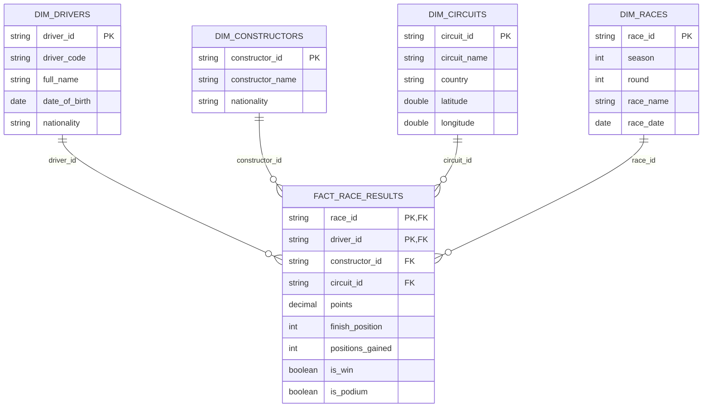

# Gold Dimensional Model

## 1. Overview

The Gold layer provides a business-oriented dimensional model for Formula 1 performance analytics.

Validated Silver race results are transformed into a Star Schema optimized for analytical SQL queries, business reporting and dashboard development.

The model covers Formula 1 seasons from 2021 to 2025.

## 2. Technology Stack

- Azure Databricks
- PySpark
- Azure Data Lake Storage Gen2
- Delta Lake
- Unity Catalog
- SQL

## 3. Source and Target

| Property | Value |
|---|---|
| Source table | `f1_lakehouse.silver.race_results` |
| Target catalog | `f1_lakehouse` |
| Target schema | `gold` |
| Storage container | `gold` |
| Storage format | Delta Lake |
| Table type | External |
| Load strategy | Full Refresh |

Storage base path:

`abfss://gold@stf1lakehouse290.dfs.core.windows.net/`

Each Gold table is stored in a separate directory.

## 4. Dimensional Model

The Gold layer follows a Star Schema architecture consisting of four dimension tables and one central fact table.



The diagram presents the main attributes and logical key relationships.

## 5. Dimension Tables

### dim_drivers

Grain: One record per unique driver.

Primary key: `driver_id`

| Column | Data type |
|---|---|
| driver_id | STRING |
| driver_code | STRING |
| first_name | STRING |
| last_name | STRING |
| full_name | STRING |
| date_of_birth | DATE |
| nationality | STRING |

Driver attributes are selected from the latest available race result.

### dim_constructors

Grain: One record per unique constructor.

Primary key: `constructor_id`

| Column | Data type |
|---|---|
| constructor_id | STRING |
| constructor_name | STRING |
| nationality | STRING |

Constructor identifiers are preserved from the source API. Historical constructor identities are not manually consolidated.

### dim_circuits

Grain: One record per unique circuit.

Primary key: `circuit_id`

| Column | Data type |
|---|---|
| circuit_id | STRING |
| circuit_name | STRING |
| city | STRING |
| country | STRING |
| latitude | DOUBLE |
| longitude | DOUBLE |

Geographical coordinates support future circuit map visualizations.

### dim_races

Grain: One record per race.

Primary key: `race_id`

| Column | Data type |
|---|---|
| race_id | STRING |
| season | INT |
| round | INT |
| race_name | STRING |
| race_date | DATE |
| race_time | STRING |

Race identifiers are generated deterministically using the season and zero-padded round number.

Example: `2025_01`

## 6. Fact Table

### fact_race_results

Grain: One driver result per race.

Composite primary key:

- `race_id`
- `driver_id`

Foreign keys:

| Foreign key | Referenced table |
|---|---|
| race_id | dim_races |
| driver_id | dim_drivers |
| constructor_id | dim_constructors |
| circuit_id | dim_circuits |

### Race Attributes and Measures

| Column | Data type |
|---|---|
| driver_number | INT |
| grid_position | INT |
| position | INT |
| position_text | STRING |
| finish_position | INT |
| status | STRING |
| points | DECIMAL(6,2) |
| positions_gained | INT |
| laps_completed | INT |
| race_time_ms | BIGINT |
| fastest_lap_rank | INT |
| fastest_lap_number | INT |
| fastest_lap_time | STRING |

### Analytical Flags

| Column | Description |
|---|---|
| is_classified | Driver has a valid classified finishing position |
| is_win | Driver finished in first position |
| is_podium | Driver finished in the top three |
| is_dnf | Driver did not finish according to Silver classification rules |
| is_dns | Driver did not start |
| is_dsq | Driver was disqualified |

All analytical flags use the BOOLEAN data type.

Race-specific constructor assignments and driver numbers are preserved in the fact table.

Classification rules and derived performance measures are inherited from the Silver layer.

## 7. Transformation Strategy

The Gold transformation is implemented in:

`notebooks/03_silver_to_gold.py`

The notebook performs the following operations:

1. Reads validated Silver data.
2. Generates deterministic race identifiers.
3. Creates dimension tables.
4. Creates the central fact table.
5. Validates primary and foreign keys.
6. Reconciles record counts and race points.
7. Validates Star Schema joins.
8. Writes Delta tables to ADLS Gen2.
9. Registers external tables in Unity Catalog.
10. Validates persisted and registered table contents.

Driver, constructor and circuit dimensions follow a Type 1 attribute strategy.

Window functions select the latest available attributes using season and round ordering, with driver identifiers providing a deterministic tie-breaker.

Historical attribute versions are not maintained.

Race attributes are deduplicated using distinct records, followed by key uniqueness validation.

## 8. Data Quality and Referential Integrity

The Gold transformation includes the following validation checks:

- Dimension primary key uniqueness.
- Composite fact key uniqueness.
- Non-null primary keys.
- Dimension record completeness.
- Fact record completeness.
- Circuit coordinate range validation.
- Foreign key integrity using left anti joins.
- Race points reconciliation.
- Star Schema integration validation.
- Delta read-back validation.
- Unity Catalog storage location validation.
- Persisted data content comparison.

Primary and foreign keys are logical model constraints validated through PySpark rather than enforced database constraints.

## 9. Validation Results

The following results were observed during development using seasons 2021–2025.

| Table | Record count |
|---|---:|
| dim_drivers | 35 |
| dim_constructors | 12 |
| dim_circuits | 28 |
| dim_races | 114 |
| fact_race_results | 2278 |

### Race Coverage

| Season | Races |
|---|---:|
| 2021 | 22 |
| 2022 | 22 |
| 2023 | 22 |
| 2024 | 24 |
| 2025 | 24 |
| Total | 114 |

### Reconciliation Results

| Validation | Result |
|---|---|
| Silver race results | 2278 |
| Gold fact records | 2278 |
| Star Schema joined records | 2278 |
| Silver total race points | 11540.50 |
| Gold total race points | 11540.50 |
| Duplicate fact keys | 0 |
| Orphan foreign keys | 0 |
| Delta read-back validation | PASSED |
| Unity Catalog validation | PASSED |

Race points represent Grand Prix race results and do not include separate sprint race results.

## 10. Full Refresh and Idempotency

All Gold tables use Delta Lake overwrite mode.

Repeated execution replaces existing logical table contents rather than appending duplicate records.

Idempotency was tested by executing the transformation twice with unchanged Silver input data.

Delta Lake Time Travel was used to compare table versions 0 and 1.

The validation compared:

- Record counts.
- Column names and data types.
- Data content using bidirectional `exceptAll()` comparisons.

| Table | Previous version | Current version | Result |
|---|---:|---:|---|
| dim_drivers | 0 | 1 | PASSED |
| dim_constructors | 0 | 1 | PASSED |
| dim_circuits | 0 | 1 | PASSED |
| dim_races | 0 | 1 | PASSED |
| fact_race_results | 0 | 1 | PASSED |

The optional historical comparison test is disabled by default because legitimate source data changes may produce different Gold table contents.

## 11. Unity Catalog Tables

The following external Delta tables are available for SQL analytics:

- `f1_lakehouse.gold.dim_drivers`
- `f1_lakehouse.gold.dim_constructors`
- `f1_lakehouse.gold.dim_circuits`
- `f1_lakehouse.gold.dim_races`
- `f1_lakehouse.gold.fact_race_results`

Unity Catalog provides centralized table discovery and access governance while physical data remains in ADLS Gen2.

## 12. Example Analytical Query

The following query calculates total race points and race entries per driver.

```sql
SELECT
    d.full_name,
    COUNT(*) AS race_entries,
    SUM(f.points) AS total_points
FROM f1_lakehouse.gold.fact_race_results AS f
JOIN f1_lakehouse.gold.dim_drivers AS d
    ON f.driver_id = d.driver_id
GROUP BY
    d.driver_id,
    d.full_name
ORDER BY
    total_points DESC,
    d.driver_id;
```

## 13. Design Decisions and Limitations

- Natural business keys are used instead of generated surrogate keys.
- Type 1 dimensions preserve the latest available attributes rather than historical attribute versions.
- Full refresh processing is appropriate for the current historical dataset size.
- Each Delta table is written in a separate transaction. The entire five-table refresh is not atomic.
- Concurrent execution and partial failure recovery have not been tested.
- Idempotency validation assumes unchanged input data and available Delta history.
- Sprint results, qualifying results, lap-level telemetry and pit stop data are outside the current MVP scope.

## 14. Next Steps

The Gold dimensional model will support:

- SQL-based business analytics.
- Driver performance analysis.
- Circuit-specific performance comparisons.
- Constructor performance reporting.
- End-to-end pipeline orchestration.
- Interactive Streamlit dashboards.