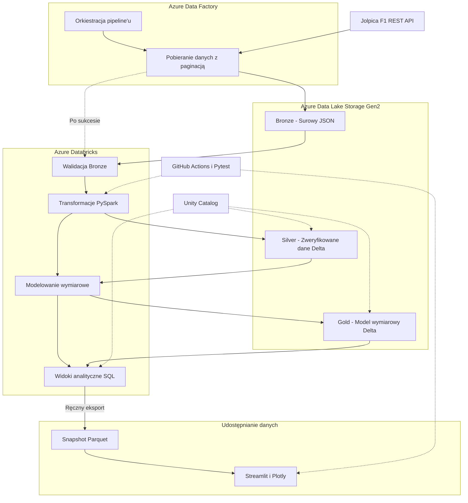
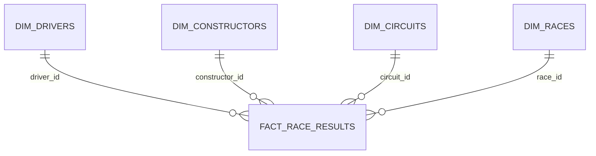
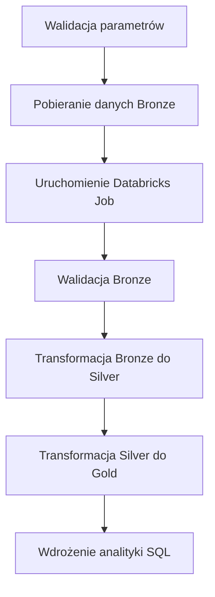

# Architektura rozwiązania

[English](../architecture.md) | [Polski](architecture.md)

## 1. Wprowadzenie

F1 Performance Analytics to kompleksowe rozwiązanie z obszaru inżynierii danych, wykorzystujące przetwarzanie wsadowe w ekosystemie Microsoft Azure.

Platforma pobiera historyczne wyniki wyścigów Formuły 1, przekształca i waliduje dane, buduje model wymiarowy oraz udostępnia interaktywną analitykę wyników.

Rozwiązanie wykorzystuje architekturę Medallion, składającą się z warstw Bronze, Silver i Gold.

## 2. Architektura wysokiego poziomu

## 3. Komponenty architektury

| Komponent | Odpowiedzialność |
|---|---|
| Jolpica F1 API | Historyczne wyniki wyścigów Formuły 1 |
| Azure Data Factory | Pobieranie danych i orkiestracja pipeline'u |
| ADLS Gen2 | Trwałe przechowywanie danych Bronze, Silver i Gold |
| Azure Databricks | Walidacja i transformacja danych |
| PySpark | Rozproszone przetwarzanie danych |
| Delta Lake | Transakcyjne tabele analityczne |
| Unity Catalog | Organizacja danych i zarządzanie dostępem |
| Databricks SQL | Biznesowe widoki analityczne |
| Apache Parquet | Przenośny snapshot danych analitycznych |
| Streamlit | Interaktywny dashboard analityczny |
| Plotly | Interaktywna wizualizacja danych |
| GitHub Actions | Ciągła integracja |
| Pytest | Testy automatyczne |

## 4. Architektura Medallion

### Warstwa Bronze

Warstwa Bronze przechowuje oryginalne odpowiedzi JSON ze źródłowego API.

- Paginacja oparta na parametrze offset.
- Stały rozmiar strony wynoszący 100 rekordów.
- Organizacja danych według sezonu i offsetu.
- Deterministyczne nazwy plików.
- Zachowanie surowych danych źródłowych.
- Walidacja metadanych i kompletności.

### Warstwa Silver

Warstwa Silver dostarcza ustrukturyzowane i zweryfikowane wyniki wyścigów.

- Jawnie zdefiniowany schemat danych.
- Spłaszczanie zagnieżdżonych struktur JSON.
- Konwersja typów danych.
- Wykrywanie duplikatów.
- Walidacja reguł biznesowych.
- Wyliczanie dodatkowych metryk.
- Zapis danych w formacie Delta Lake.

Tabela docelowa: `f1_lakehouse.silver.race_results`

### Warstwa Gold

Warstwa Gold udostępnia model wymiarowy dostosowany do potrzeb analityki biznesowej.

- Cztery tabele wymiarów.
- Jedna centralna tabela faktów.
- Schemat gwiazdy (Star Schema).
- Walidacja logicznych kluczy głównych i obcych.
- Widoki analityczne SQL.
- Uzgadnianie liczby rekordów i punktów.

## 5. Model wymiarowy danych

### Granularność danych

| Tabela | Granularność | Początkowa liczba rekordów |
|---|---|---:|
| dim_drivers | Jeden kierowca | 35 |
| dim_constructors | Jeden konstruktor | 12 |
| dim_circuits | Jeden tor | 28 |
| dim_races | Jeden wyścig | 114 |
| fact_race_results | Jeden wynik kierowcy w wyścigu | 2 278 |

Klucz biznesowy warstwy Silver składa się z kolumn `season`, `round` oraz `driver_id`.

Tabela faktów warstwy Gold wykorzystuje klucz złożony z `race_id` oraz `driver_id`.

Podane liczby dotyczą zweryfikowanego zbioru historycznego obejmującego sezony 2021–2025.

## 6. Orkiestracja pipeline'u

Głównym pipeline'em Azure Data Factory jest `pl_f1_end_to_end`.

Pipeline obsługuje dwa tryby wykonania:

- Pełne ładowanie danych historycznych.
- Odświeżenie wybranego sezonu.

Odświeżenie wybranego sezonu aktualizuje dane Bronze dla wskazanego sezonu, a następnie przebudowuje warstwy Silver i Gold na podstawie kompletnego historycznego zbioru Bronze.

Zależne etapy przetwarzania uruchamiają się wyłącznie po pomyślnym zakończeniu wcześniejszych operacji.

## 7. Warstwa udostępniania danych

Schemat analityczny Gold udostępnia sześć widoków SQL:

- `vw_race_results`
- `vw_driver_circuit_history`
- `vw_driver_circuit_performance`
- `vw_driver_positions_gained`
- `vw_driver_season_performance`
- `vw_constructor_circuit_performance`

Dashboard Streamlit wykorzystuje snapshot Parquet wyeksportowany z widoku:

`f1_lakehouse.analytics.vw_race_results`

Początkowy snapshot zawiera 2 278 rekordów i 38 kolumn.

Eksport snapshotu jest oddzielną operacją wykonywaną ręcznie i nie stanowi części głównego pipeline'u orkiestracyjnego.

Takie rozwiązanie umożliwia uruchomienie dashboardu bez danych uwierzytelniających Azure i aktywnych zasobów obliczeniowych w chmurze.

## 8. Jakość i niezawodność danych

Mechanizmy kontroli jakości zostały zaimplementowane w poszczególnych warstwach przetwarzania.

- Walidacja paginacji API i kompletności rekordów.
- Walidacja schematu.
- Unikalność kluczy biznesowych.
- Walidacja wartości liczbowych.
- Integralność referencyjna.
- Uzgadnianie punktów wyścigowych.
- Walidacja danych po odczycie z tabel Delta.
- Automatyczne testy jednostkowe.
- Walidacja idempotentności na poziomie zawartości danych.

Niepowodzenie walidacji zatrzymuje zależne etapy przetwarzania.

Nie zaimplementowano mechanizmu transakcyjnego wycofywania zmian obejmującego wiele tabel.

## 9. Decyzje architektoniczne

| Decyzja | Uzasadnienie |
|---|---|
| Przetwarzanie wsadowe | Dopasowanie do historycznych danych wyścigowych |
| Architektura Medallion | Rozdzielenie danych surowych, zweryfikowanych i analitycznych |
| Pełne odświeżanie | Prostota przy obecnej wielkości zbioru |
| Delta Lake | Transakcyjny zapis i historia wersji |
| Schemat gwiazdy | Ułatwienie analityki biznesowej SQL |
| Naturalne klucze biznesowe | Powiązanie z identyfikatorami źródłowymi |
| Wymiary typu 1 | Uproszczone zarządzanie wymiarami |
| Serverless compute | Brak konieczności utrzymywania stałych zasobów obliczeniowych |
| Managed Identity | Ograniczenie zarządzania danymi uwierzytelniającymi |
| Snapshot Parquet | Przenośny dashboard bez dostępu do chmury |
| Ręczne uruchamianie | Kontrola kosztów środowiska deweloperskiego |

## 10. Zakres i ograniczenia

MVP obejmuje historyczne wyniki wyścigów Grand Prix z sezonów 2021–2025.

Rozwiązanie nie implementuje przetwarzania strumieniowego w czasie rzeczywistym, przyrostowego przetwarzania warstw Silver i Gold, historycznych wersji wymiarów, automatycznego wdrażania infrastruktury ani transakcyjnego wycofywania zmian obejmującego wiele tabel.

Wyniki sprintów, kwalifikacje, telemetria na poziomie okrążeń oraz analiza pit stopów pozostają poza zakresem obecnego MVP.

## 11. Powiązana dokumentacja

Poniższe odnośniki prowadzą do istniejącej dokumentacji anglojęzycznej.

- [Konfiguracja Azure](../azure_setup.md)
- [Źródło danych](../data_source.md)
- [Pobieranie danych Bronze](../bronze_ingestion.md)
- [Transformacje Silver](../silver_transformations.md)
- [Model wymiarowy Gold](../gold_dimensional_model.md)
- [Analityka biznesowa SQL](../sql_business_analytics.md)
- [Orkiestracja pipeline'u](../end_to_end_pipeline.md)
- [Jakość danych i CI](../data_quality_and_ci.md)
- [Dashboard Streamlit](../../dashboard/README.md)
- [Główny README](../../README.md)