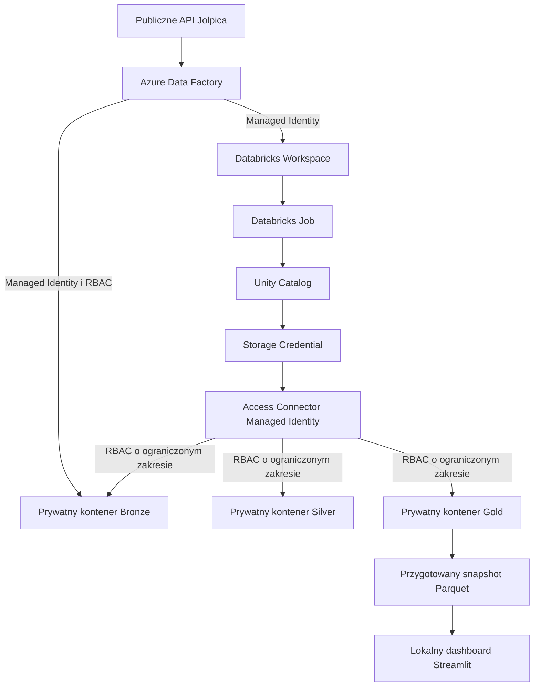

# Koszty, bezpieczeństwo i kompromisy techniczne

[English](../costs_security_tradeoffs.md) | [Polski](costs_security_tradeoffs.md)

## 1. Wprowadzenie

F1 Azure Data Lakehouse to edukacyjny projekt portfolio Data Engineering, zaprojektowany z uwzględnieniem architektury chmurowej, bezpieczeństwa, odtwarzalności, kosztów oraz złożoności implementacji.

MVP celowo nie wykorzystuje zbędnej infrastruktury produkcyjnej.

## 2. Infrastruktura Azure

| Zasób | Konfiguracja | Region |
|---|---|---|
| Subskrypcja | Azure for Students | Nie dotyczy |
| Resource Group | Środowisko deweloperskie | West Europe |
| ADLS Gen2 | Standard LRS, Hot Tier | West Europe |
| Azure Data Factory | V2 | Poland Central |
| Azure Databricks | Premium, Serverless Compute | Germany West Central |
| Databricks Access Connector | Managed Identity | West Europe |

Konfiguracja regionalna wynika z dostępności usług podczas realizacji projektu.

Region West Europe był niedostępny dla nowych środowisk Databricks. Jako alternatywę wybrano Germany West Central.

Wersja próbna Databricks nie była obsługiwana przez subskrypcję Azure for Students.

## 3. Zarządzanie kosztami

### 3.1. Konfiguracja budżetu

| Właściwość | Wartość |
|---|---|
| Budżet miesięczny | 10 USD lub równowartość w walucie rozliczeniowej |
| Pierwszy alert | 50% |
| Drugi alert | 80% |
| Trzeci alert | 100% |
| Harmonogram pipeline'u | Nieskonfigurowany |
| Strategia wykonania | Ręczna |

Alerty budżetowe Azure informują o wydatkach, ale nie zatrzymują automatycznie zużycia zasobów.

Skonfigurowany budżet jest progiem monitorowania, a nie gwarantowanym limitem wydatków.

### 3.2. Źródła kosztów

| Komponent | Potencjalne źródła kosztów |
|---|---|
| Azure Data Factory | Wykonywanie aktywności, orkiestracja i transfer danych |
| ADLS Gen2 | Przechowywanie danych, transakcje i transfer |
| Azure Databricks | Wykorzystanie Serverless Compute |
| Architektura wieloregionowa | Transfer danych pomiędzy regionami |
| GitHub Actions | Wykorzystanie runnerów zależnie od limitów konta |
| Lokalny dashboard | Brak dodatkowego wykorzystania zasobów obliczeniowych Azure |

Rzeczywiste koszty zależą od konfiguracji zasobów, wykorzystania usług, regionu i obowiązujących cen.

Szczegółowe dane rozliczeniowe nie zostały zebrane na potrzeby tej dokumentacji. Nie podano zweryfikowanego całkowitego kosztu projektu ani kosztu pojedynczego wykonania.

### 3.3. Decyzje optymalizujące koszty

- Wykorzystanie Serverless Compute zamiast stale działających klastrów Spark.
- Ręczne uruchamianie przetwarzania chmurowego.
- Brak zbędnych harmonogramów cyklicznych.
- Wykorzystanie magazynu Standard LRS w środowisku deweloperskim.
- Odświeżanie wybranych sezonów historycznych.
- Ograniczenie zbędnych automatycznych ponowień.
- Wykonywanie testów jednostkowych poza Azure.
- Udostępnianie dashboardu na podstawie lokalnego snapshotu Parquet.
- Monitorowanie wydatków za pomocą alertów budżetowych.

Serverless Compute ogranicza konieczność zarządzania stałymi klastrami, ale nie gwarantuje niższych kosztów dla każdego rodzaju obciążenia.

## 4. Zaobserwowana poprawa wydajności

Testy End-to-End wykonano 27 listopada 2026 r.

| Etap przetwarzania | Pełne ładowanie | Odświeżenie sezonu | Redukcja czasu |
|---|---|---|---:|
| Pobieranie Bronze | 11 min 53 s | 2 min 23 s | 79,9% |
| Aktywność Databricks Job | 4 min 44 s | 4 min 30 s | 4,9% |
| Całkowity czas | 16 min 37 s | 6 min 53 s | 58,6% |

Odświeżenie wybranego sezonu skróciło zaobserwowany czas wykonania o około 9 minut i 44 sekundy.

Największa poprawa wystąpiła w warstwie Bronze, ponieważ pobrano jeden sezon zamiast pięciu.

Transformacje Silver i Gold nadal przetwarzały kompletny zbiór historyczny.

Pomiary dotyczą pojedynczych wykonań testowych, a nie statystycznego benchmarku wydajności.

Redukcja czasu wykonania nie oznacza identycznej procentowej redukcji kosztów Azure.

## 5. Architektura bezpieczeństwa

## 6. Zarządzanie tożsamością i dostępem

### 6.1. Azure Data Factory

Azure Data Factory wykorzystuje systemową Managed Identity.

Dostęp do magazynu danych jest nadawany za pomocą roli Storage Blob Data Contributor ograniczonej do kontenera Bronze.

Tożsamość odpowiedzialna za pobieranie danych nie wymaga nieograniczonego dostępu do kontenerów Silver i Gold.

### 6.2. Databricks Access Connector

Databricks Access Connector wykorzystuje uwierzytelnianie Managed Identity.

| Uprawnienie | Zakres |
|---|---|
| Storage Blob Delegator | Konto magazynu danych |
| Storage Blob Data Contributor | Kontener Bronze |
| Storage Blob Data Contributor | Kontener Silver |
| Storage Blob Data Contributor | Kontener Gold |

Zapis do Bronze jest ograniczony na poziomie external location w Unity Catalog.

Bazowa rola Azure RBAC nadal umożliwia zapis. Konfiguracja tylko do odczytu w Unity Catalog nie jest równoznaczna z blokadą zapisu na poziomie Azure Storage.

### 6.3. Unity Catalog

| External location | Tryb dostępu |
|---|---|
| loc_f1_bronze | Tylko odczyt |
| loc_f1_silver | Odczyt i zapis |
| loc_f1_gold | Odczyt i zapis |

Dostęp do magazynu danych jest zarządzany za pomocą storage credentials oraz external locations w Unity Catalog.

### 6.4. Integracja ADF z Databricks

Managed Identity usługi ADF jest zarejestrowana w Databricks jako zarządzany service principal Microsoft Entra ID.

| Zakres | Uprawnienie |
|---|---|
| Zasób Azure Databricks | Contributor |
| Databricks Workspace | Dostęp do workspace |
| Databricks Job | Can Manage Run |

Rola Contributor w Azure jest ograniczona do zasobu Databricks Workspace.

Databricks Job jest wykonywany przy użyciu skonfigurowanej tożsamości użytkownika workspace.

W środowisku produkcyjnym dedykowany service principal dla wykonania Job zapewniłby lepsze rozdzielenie tożsamości.

## 7. Ochrona danych i prywatność

Projekt przetwarza publicznie dostępne historyczne wyniki wyścigów Formuły 1.

Zbiór zawiera publiczne informacje dotyczące kierowców, takie jak imiona, nazwiska, narodowości i wyniki sportowe.

Publiczna dostępność danych nie znosi wszystkich obowiązków związanych z prywatnością i licencjonowaniem.

Zaimplementowane zabezpieczenia magazynu danych obejmują:

- Prywatne kontenery.
- Wyłączony dostęp anonimowy.
- Włączony bezpieczny transfer danych.
- Uwierzytelnianie Managed Identity.
- Uprawnienia Azure RBAC o ograniczonym zakresie.
- Zarządzanie dostępem przez Unity Catalog.

Opublikowany snapshot dashboardu zawiera przygotowane dane wyścigowe, a nie dane uwierzytelniające Azure.

Projekt jest przeznaczony do celów edukacyjnych i niekomercyjnej demonstracji portfolio.

Informacje o źródle i licencji znajdują się w [dokumentacji zbioru danych](../../dashboard/data/README.md).

## 8. Zarządzanie sekretami

Projekt wykorzystuje Managed Identity zamiast zapisanych w kodzie kluczy konta magazynu lub osobistych tokenów dostępu w integracjach chmurowych.

Konfiguracja repozytorium nie powinna zawierać:

- Haseł.
- Personal Access Tokens.
- Client secrets.
- Kluczy kont magazynu.
- Tokenów SAS.
- Poufnych connection strings.

Szablony konfiguracji zależnej od środowiska muszą zostać zweryfikowane przed publikacją.

Nazwy i identyfikatory zasobów nie zawsze są sekretami uwierzytelniającymi, jednak zbędne szczegóły infrastruktury należy ograniczać w publicznej dokumentacji.

Przed wydaniem MVP wymagany jest końcowy audyt bezpieczeństwa repozytorium i historii Git.

## 9. Bezpieczeństwo sieciowe

Środowisko deweloperskie wykorzystuje publiczne endpointy usług w celu ograniczenia złożoności infrastruktury.

Publiczne endpointy nie oznaczają anonimowego dostępu do danych magazynu.

MVP nie implementuje w pełni odizolowanej prywatnej architektury sieciowej.

Potencjalne usprawnienia produkcyjne:

- Private Endpoints.
- Ograniczony dostęp sieciowy.
- Dedykowane tożsamości wykonawcze.
- Scentralizowane monitorowanie bezpieczeństwa.
- Okresowe przeglądy uprawnień.
- Automatyczne skanowanie sekretów.

## 10. Decyzje techniczne i kompromisy

| Decyzja | Korzyść | Kompromis |
|---|---|---|
| Azure Data Factory | Zarządzane pobieranie danych i orkiestracja | Konfiguracja zależna od Azure |
| Databricks Serverless | Mniej administracji zasobami obliczeniowymi | Koszty zależne od wykorzystania i dostępności regionalnej |
| Medallion Architecture | Rozdzielenie etapów przetwarzania | Dodatkowe warstwy magazynowania i przetwarzania |
| Delta Lake | Transakcyjny zapis tabel i historia wersji | Dodatkowe metadane i utrzymanie magazynu |
| Pełne odświeżanie | Proste i przewidywalne przetwarzanie | Ponowne przetwarzanie niezmienionych danych |
| Sekwencyjne pobieranie | Łatwiejsze diagnozowanie i kontrola | Dłuższy czas dla większych zbiorów |
| Schemat gwiazdy | Czytelny model analityczny | Dodatkowe połączenia i zarządzanie wymiarami |
| Naturalne klucze biznesowe | Powiązanie ze źródłem | Zależność od stabilności identyfikatorów źródłowych |
| Wymiary typu 1 | Prosta aktualizacja wymiarów | Brak historycznych wersji atrybutów |
| Standardowe widoki SQL | Wielokrotne wykorzystanie logiki biznesowej | Obliczenia podczas wykonywania zapytań |
| Lokalny snapshot Parquet | Przenośna i niedroga demonstracja | Ręczne odświeżanie i brak połączenia z chmurą na żywo |
| Ręczna orkiestracja | Kontrola kosztów deweloperskich | Brak automatycznej gwarancji aktualności danych |
| GitHub Actions CI | Ochrona przed regresjami bez Azure | Brak pełnych testów integracyjnych chmury |
| Ręczna konfiguracja infrastruktury | Mniejszy nakład pracy w MVP | Kroki wdrożeniowe zależne od środowiska |
| Standard LRS | Niższa złożoność i koszt środowiska | Ograniczona redundancja względem opcji geograficznych |

## 11. Niezawodność i obsługa błędów

Pipeline orkiestracyjny waliduje parametry wejściowe przed pobieraniem danych.

Zależne aktywności wykonują się wyłącznie po pomyślnym zakończeniu wcześniejszych etapów.

Databricks Job jest skonfigurowany z maksymalnie jednym równoległym wykonaniem i włączonym kolejkowaniem.

Projekt obejmuje:

- Mechanizmy ponawiania operacji API i pobierania danych.
- Walidację jakości na poziomie notebooków.
- Walidację kluczy biznesowych.
- Kontrolę integralności referencyjnej.
- Uzgadnianie liczby rekordów i punktów.
- Walidację idempotentności zawartości Delta.
- Automatyczne testy jednostkowe.

Delta Lake zapewnia gwarancje transakcyjne na poziomie pojedynczej tabeli.

Nie zaimplementowano transakcyjnego wycofywania zmian obejmującego wiele tabel.

Równoległe wykonywanie pipeline'ów ADF nie zostało w pełni przetestowane.

## 12. Znane ograniczenia

- Zakres historyczny ograniczony do sezonów 2021–2025.
- Wyłącznie wyniki Grand Prix.
- Brak przetwarzania strumieniowego w czasie rzeczywistym.
- Brak przyrostowych transformacji Silver i Gold.
- Brak historycznych wersji wymiarów.
- Ręczne odświeżanie snapshotu dashboardu.
- Brak automatycznego tworzenia infrastruktury.
- Brak pełnych testów integracyjnych chmury w CI.
- Brak kompleksowego monitorowania produkcyjnego.
- Brak w pełni odizolowanej prywatnej architektury sieciowej.
- Brak zweryfikowanego benchmarku kosztów pojedynczego wykonania.

## 13. Rozważania dotyczące środowiska produkcyjnego

Implementacja produkcyjna powinna uwzględniać skalę przetwarzania, wymagania dotyczące aktualności danych, cele odtwarzania po awarii, polityki bezpieczeństwa i budżety operacyjne.

Potencjalne usprawnienia obejmują przetwarzanie przyrostowe, lepsze rozdzielenie tożsamości, izolację sieciową, automatyzację wdrożeń, rozszerzone monitorowanie oraz przypisywanie kosztów do poszczególnych obciążeń.

Usprawnienia te pozostają poza zakresem aktualnego MVP.

## 14. Powiązana dokumentacja

- [Architektura rozwiązania](architecture.md)
- [Konfiguracja Azure (EN)](../azure_setup.md)
- [Konfiguracja i odtwarzalność](setup.md)
- [Pipeline End-to-End (EN)](../end_to_end_pipeline.md)
- [Jakość danych i CI](data_quality_and_ci.md)
- [Demonstracja portfolio](portfolio_demo.md)
- [Zbiór danych dashboardu (EN)](../../dashboard/data/README.md)