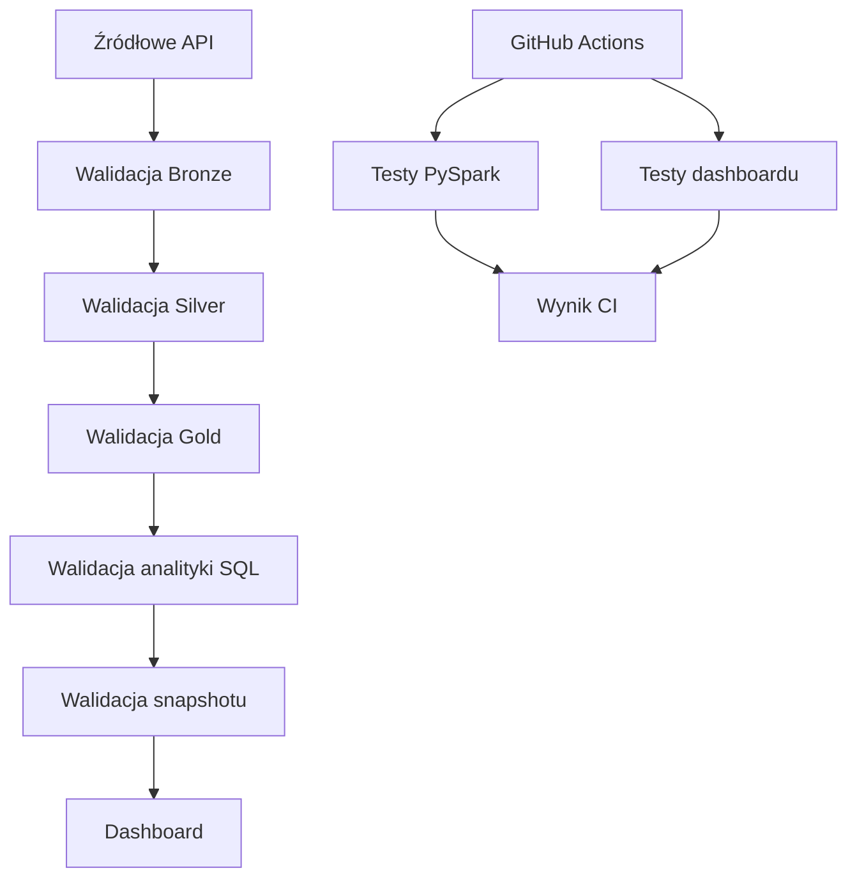
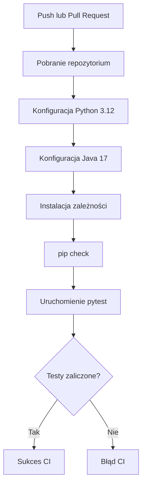

# Jakość danych i CI

[English](../data_quality_and_ci.md) | [Polski](data_quality_and_ci.md)

## 1. Wprowadzenie

Projekt F1 Azure Data Lakehouse wykorzystuje mechanizmy kontroli jakości danych na etapach pobierania, transformacji, modelowania wymiarowego, analityki i udostępniania danych w dashboardzie.

Automatyczne testy i ciągła integracja chronią logikę biznesową przed regresjami.

Walidacja integracyjna środowiska chmurowego jest wykonywana oddzielnie w Azure Databricks.

## 2. Architektura kontroli jakości



## 3. Walidacja poszczególnych warstw

| Warstwa | Walidacja |
|---|---|
| Bronze | Paginacja, metadane, zakres sezonów i kompletność |
| Silver | Schemat, klucze biznesowe, punkty i metryki |
| Gold | Klucze główne, obce i uzgadnianie rekordów |
| Analytics | Dostępność widoków, rankingi i spójność metryk |
| Snapshot | Schemat, metadane, liczba rekordów i klucze |
| Dashboard | Filtry, KPI, agregacje i generowanie wykresów |

Niepowodzenie walidacji na poziomie notebooka zatrzymuje zależne etapy przetwarzania.

Zapytania walidacyjne SQL wymagają ręcznej kontroli tam, gdzie nie zaimplementowano automatycznego przerywania wykonania.

## 4. Wielokrotnego użytku logika transformacji

| Funkcja | Odpowiedzialność |
|---|---|
| cast_race_results() | Konwersja wartości do odpowiednich typów Spark |
| normalize_strings() | Usuwanie zbędnych spacji i zamiana pustych wartości na NULL |
| deduplicate_records() | Usuwanie identycznych duplikatów |

Implementacja:

- `src/transformations.py`
- `src/data_quality.py`

Sprzeczne rekordy posiadające ten sam klucz biznesowy są odrzucane zamiast automatycznego usuwania.

Nieprawidłowe rekordy wykryte przez współdzielone funkcje walidacyjne powodują zgłoszenie wyjątku `DataQualityError`.

## 5. Reguły biznesowe

| Reguła | Oczekiwane zachowanie |
|---|---|
| Unikalność klucza | Odrzucenie zduplikowanych kluczy |
| Kompletność klucza | Odrzucenie wartości NULL w kluczu |
| Kompletność punktów | Odrzucenie punktów NULL |
| Nieujemne punkty | Odrzucenie wartości ujemnych |
| Punkty ułamkowe | Zachowanie wartości dziesiętnych |
| Identyczne duplikaty | Usunięcie identycznych rekordów |
| Wynik nieklasyfikowany | Zachowanie brakującej pozycji końcowej |
| Zyskane pozycje | Wymagana prawidłowa pozycja startowa i klasyfikacja |
| Integralność referencyjna | Odrzucenie kluczy bez dopasowania w wymiarach |

Klucz biznesowy Silver:

`season + round + driver_id`

Klucz biznesowy tabeli faktów Gold:

`race_id + driver_id`

Klucze główne i obce są ograniczeniami logicznymi walidowanymi przez kod przetwarzający dane.

## 6. Zakres testów automatycznych

Łączny zestaw testów MVP zawiera 57 testów.

| Zestaw testów | Liczba |
|---|---:|
| Transformacje PySpark i jakość danych | 21 |
| Analityka dashboardu, ładowanie danych i wykresy | 36 |
| Łącznie | 57 |

Pełny zestaw testów został pomyślnie wykonany lokalnie podczas realizacji MVP.

### Testy PySpark

| Kategoria | Liczba testów |
|---|---:|
| Konwersja typów danych | 5 |
| Normalizacja tekstu | 4 |
| Deduplikacja | 3 |
| Walidacja jakości danych | 9 |
| Łącznie | 21 |

### Testy dashboardu

Zakres obejmuje:

- Ładowanie snapshotu.
- Walidację wymaganego schematu.
- Spójność metadanych.
- Walidację kluczy biznesowych.
- Filtrowanie kierowców i torów.
- Wybór ostatnich N wyścigów.
- Obliczanie KPI.
- Obsługę pustych wyników.
- Obsługę wyników nieklasyfikowanych.
- Agregacje według torów i konstruktorów.
- Generowanie wykresów Plotly.

## 7. Struktura testów

```text
tests/
├── conftest.py
├── test_transformations.py
└── test_data_quality.py

dashboard/tests/
├── conftest.py
├── test_analytics.py
├── test_data_loader.py
└── test_charts.py
```

Testy wykorzystują kontrolowane dane testowe i nie wymagają aktywnych usług Azure.

## 8. Lokalne uruchamianie testów

Wymagania:

- Python 3.12
- Java 17
- Środowisko wirtualne Python

Instalacja zależności:

```bash
python -m pip install -r requirements-dev.txt
python -m pip install -r dashboard/requirements.txt
```

Sprawdzenie spójności zależności:

```bash
python -m pip check
```

Uruchomienie pełnego zestawu testów:

```bash
python -m pytest -q
```

Oczekiwany wynik bazowy MVP:

```text
57 passed
```

Uruchomienie poszczególnych zestawów:

```bash
python -m pytest tests -v
python -m pytest dashboard/tests -v
```

Podczas lokalnego testowania PySpark zaobserwowano ostrzeżenie dotyczące kompatybilności Pandas. Przed rozszerzeniem operacji Spark zależnych od Pandas należy zweryfikować zgodność zależności.

## 9. CI

Workflow:

`.github/workflows/ci.yml`

Workflow uruchamia się automatycznie podczas:

- Push do brancha main.
- Push do branchy feature.
- Pull Request kierowanego do main.



Runner Ubuntu udostępniany przez GitHub instaluje zależności deweloperskie i zależności dashboardu.

Konfiguracja pytest wykrywa testy w katalogach `tests/` oraz `dashboard/tests/`.

Workflow wykorzystuje uprawnienia repozytorium tylko do odczytu i nie wdraża infrastruktury chmurowej.

## 10. Walidacja integracyjna Azure

Pierwotny zweryfikowany zbiór historyczny dostarczył następujących wyników.

| Metryka | Wartość |
|---|---:|
| Pliki JSON Bronze | 25 |
| Rekordy Silver | 2 278 |
| Rekordy faktów Gold | 2 278 |
| Wyniki klasyfikowane | 2 007 |
| DNF | 288 |
| DNS | 14 |
| DSQ | 11 |
| Zwycięstwa | 114 |
| Podia | 342 |
| Zduplikowane klucze biznesowe | 0 |
| Klucze obce bez dopasowania | 0 |
| Widoki analityczne | 6 |

Flagi DNF i klasyfikacji nie wykluczają się wzajemnie.

### Uzgadnianie punktów

| Warstwa | Łączna liczba punktów |
|---|---:|
| Silver | 11 540,50 |
| Gold | 11 540,50 |
| Analytics | 11 540,50 |

Uzgadnianie obejmuje wyłącznie punkty wyścigów Grand Prix.

## 11. Idempotentność

Transformacje Silver i Gold wykorzystują tryb nadpisywania Delta.

Idempotentność na poziomie zawartości danych została zweryfikowana dla historycznego zbioru przy użyciu Delta Lake Time Travel.

Walidacja obejmowała:

- Porównanie schematów.
- Porównanie liczby rekordów.
- Unikalność kluczy biznesowych.
- Dwukierunkowe porównanie exceptAll.

Ponowne przetworzenie niezmienionych danych historycznych dało równoważną zawartość tabel w testowanej sekwencji uruchomień.

Nie gwarantuje to idempotentności dla wszystkich przyszłych zmian źródła ani scenariuszy równoległego wykonania.

## 12. Walidacja End-to-End

| Scenariusz | Udokumentowany wynik |
|---|---|
| Pełne ładowanie historyczne | PASS |
| Odświeżenie wybranego sezonu | PASS |
| Odrzucenie nieprawidłowych parametrów | PASS |
| Walidacja liczby rekordów | PASS |
| Unikalność kluczy biznesowych | PASS |
| Spójność zawartości Delta | PASS |
| Walidacja magazynu Bronze | PASS |
| Walidacja widoków analitycznych | PASS |
| Uzgadnianie punktów | PASS |

Dowody wykonania znajdują się w [dokumentacji pipeline'u End-to-End](../end_to_end_pipeline.md).

## 13. Bezpieczeństwo i koszty

- Brak wymaganych danych uwierzytelniających Azure podczas lokalnych testów.
- Brak wymaganych aktywnych zasobów chmurowych podczas CI.
- Uprawnienia GitHub Actions tylko do odczytu.
- Kontrolowane dane testowe.
- Ręczne testowanie integracyjne środowiska chmurowego.
- Brak automatycznego wdrażania infrastruktury.

## 14. Ograniczenia

- CI nie wykonuje pełnego pipeline'u Azure.
- Nie wszystkie walidacje SQL automatycznie przerywają wykonanie.
- Brak transakcyjnego wycofywania zmian obejmującego wiele tabel.
- Równoległe wykonywanie pipeline'u nie zostało w pełni przetestowane.
- Automatyczne raportowanie pokrycia testami pozostaje poza zakresem MVP.
- Kompatybilność Pandas wymaga dalszego monitorowania.

## 15. Przyszłe usprawnienia

- Automatyczne egzekwowanie asercji SQL.
- Dodatkowe scenariusze nieprawidłowych danych wejściowych.
- Rozszerzenie testów modelu wymiarowego.
- Automatyczne raportowanie pokrycia testami.
- Kontrola kompatybilności zależności.
- Kontrolowana automatyzacja wdrażania.

## 16. Powiązana dokumentacja

- [Architektura rozwiązania](architecture.md)
- [Analityka biznesowa SQL](sql_business_analytics.md)
- [Pipeline End-to-End (EN)](../end_to_end_pipeline.md)
- [Konfiguracja i odtwarzalność](setup.md)
- [Dokumentacja dashboardu (EN)](../../dashboard/README.md)