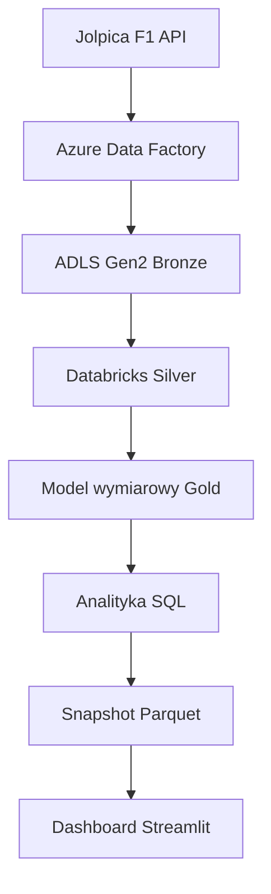
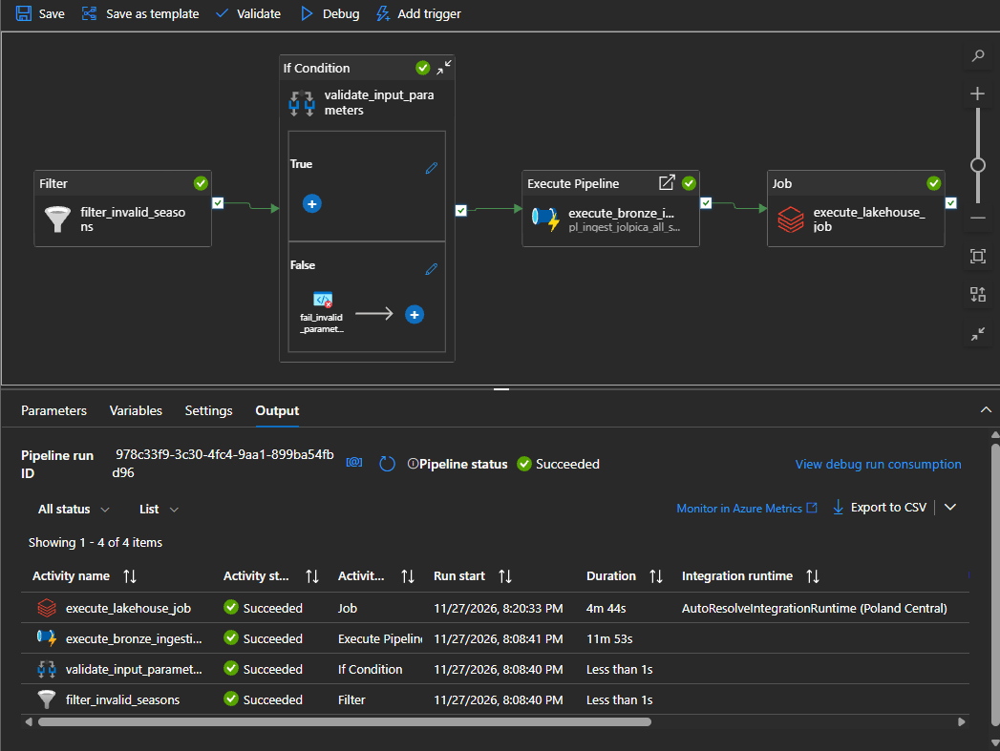
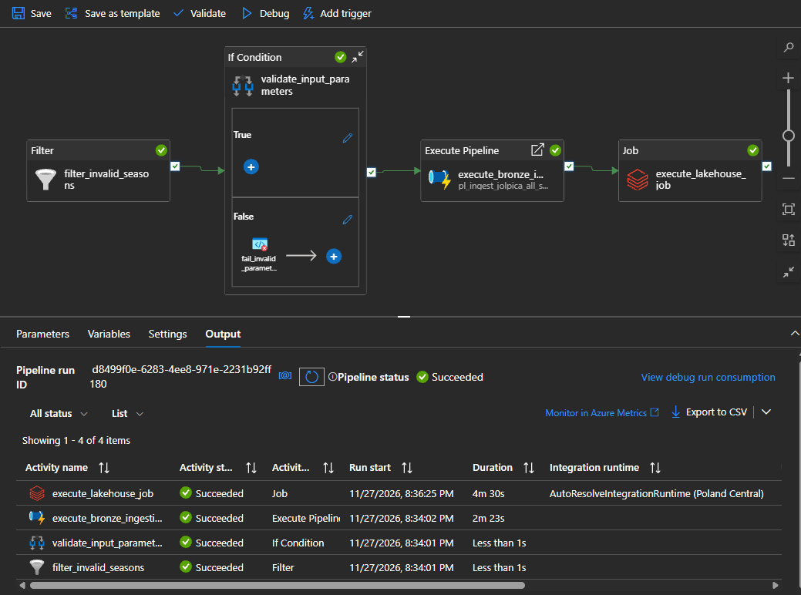
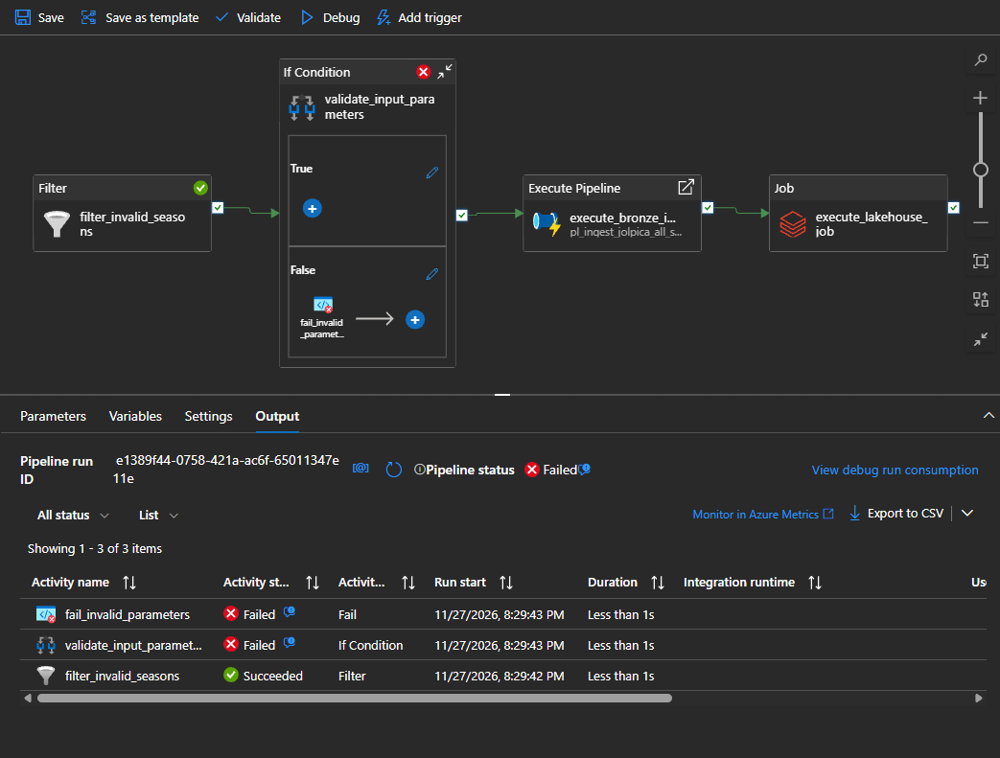
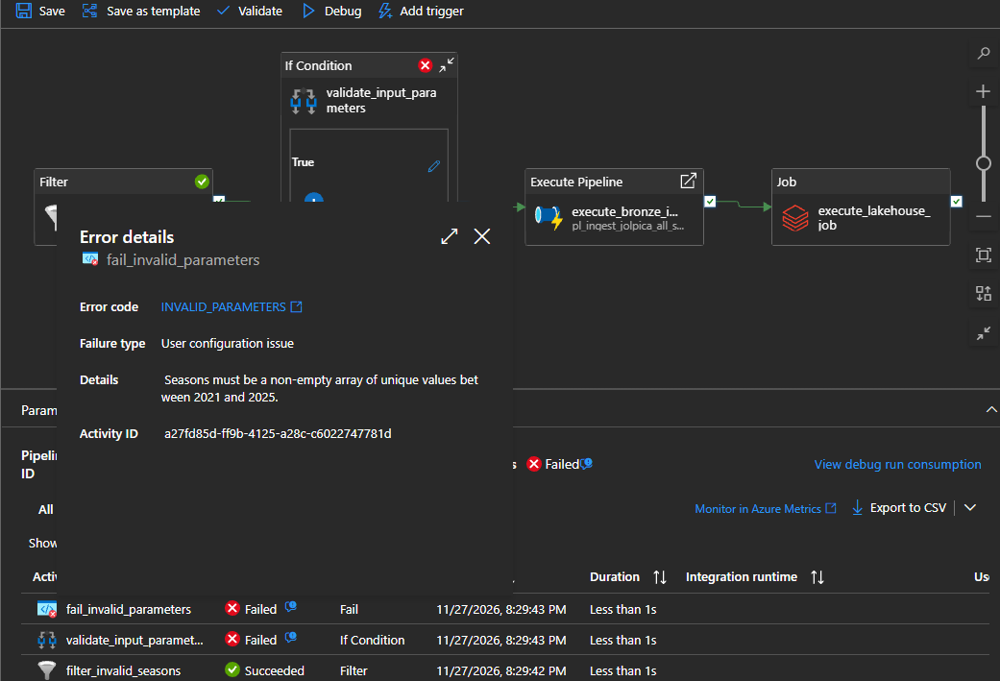
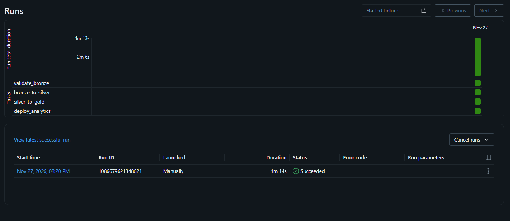
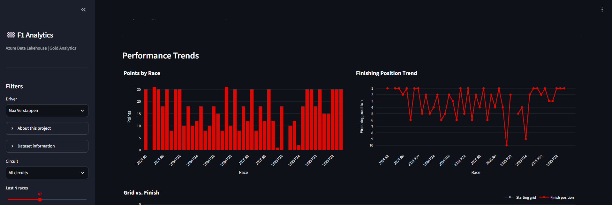
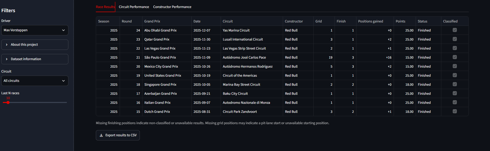
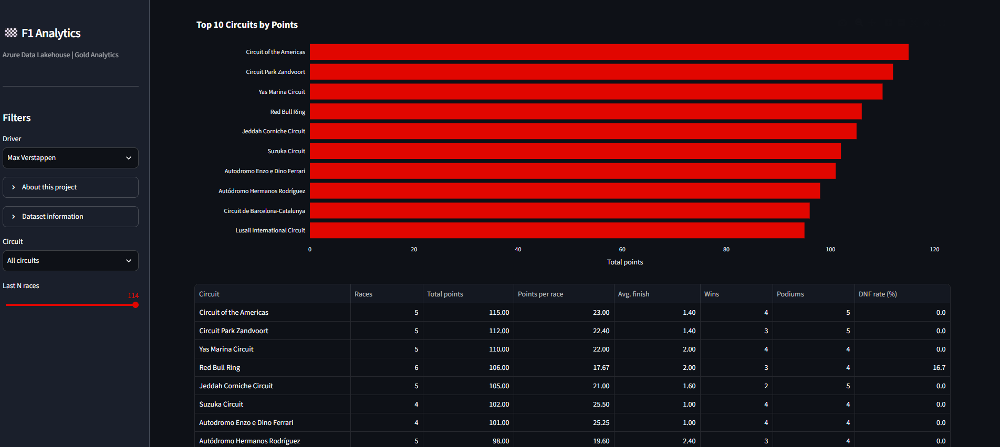
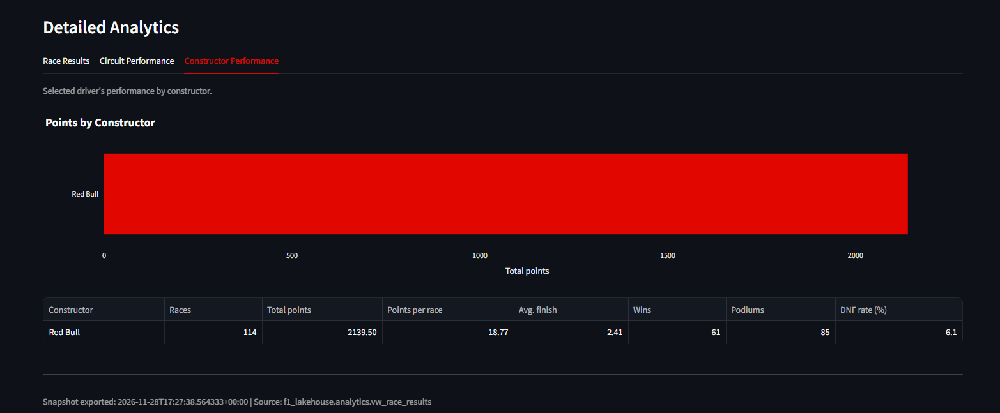

# Demonstracja portfolio i dowody wykonania

[English](../portfolio_demo.md) | [Polski](portfolio_demo.md)

## 1. Wprowadzenie

Dokument przedstawia dowody wykonania oraz zrzuty ekranu aplikacji projektu F1 Performance Analytics.

Zrzuty ekranu prezentują zaimplementowany pipeline Azure Data Lakehouse, orkiestrację, mechanizmy walidacji oraz interaktywny dashboard analityczny.

Projekt przetwarza historyczne wyniki wyścigów Grand Prix Formuły 1 z sezonów 2021–2025.

## 2. Architektura rozwiązania



## 3. Azure Data Factory

### 3.1. Pomyślne wykonanie pipeline'u End-to-End



Prezentowane funkcjonalności:

- Orkiestracja pipeline'u.
- Pobieranie danych historycznych.
- Zarządzanie zależnościami pomiędzy aktywnościami.
- Integracja z Databricks Job.
- Monitorowanie wykonania End-to-End.

### 3.2. Odświeżenie wybranego sezonu



Pipeline orkiestracyjny umożliwia odświeżanie wybranych sezonów historycznych.

Transformacje Silver i Gold przebudowują kompletny zbiór historyczny na podstawie dostępnych danych Bronze.

### 3.3. Obsługa nieprawidłowych parametrów



Nieprawidłowe parametry wejściowe są odrzucane przez pipeline orkiestracyjny.

Przedstawia to mechanizmy walidacji wejścia i kontrolowanej obsługi błędów.

### 3.4. Szczegóły błędu



Informacje diagnostyczne wspierają rozwiązywanie problemów oraz analizę nieudanych wykonań pipeline'u.

## 4. Azure Databricks

### 4.1. Pomyślne wykonanie Databricks Job



Databricks Job orkiestruje następujące etapy:

1. Walidacja Bronze.
2. Transformacja Bronze-to-Silver.
3. Transformacja Silver-to-Gold.
4. Wdrożenie analityki SQL.

Zadania wykonywane są zgodnie ze skonfigurowanymi zależnościami.

## 5. Zweryfikowany zbiór historyczny

| Metryka | Wartość |
|---|---:|
| Sezony historyczne | 5 |
| Pliki JSON Bronze | 25 |
| Wyścigi Grand Prix | 114 |
| Kierowcy | 35 |
| Konstruktorzy | 12 |
| Tory | 28 |
| Rekordy tabeli faktów Gold | 2 278 |
| Widoki analityczne | 6 |
| Zduplikowane klucze biznesowe | 0 |
| Klucze obce bez dopasowania | 0 |
| Lokalnie zaliczone testy automatyczne | 57 |

Wartości przedstawiają zweryfikowany stan bazowy MVP.

Są to historyczne wyniki prac deweloperskich, a nie metryki monitorowane na żywo.

## 6. Dashboard Streamlit

Dashboard wykorzystuje przygotowany snapshot Parquet wyeksportowany z warstwy analitycznej Gold.

Może zostać uruchomiony lokalnie bez danych uwierzytelniających Azure i aktywnych zasobów obliczeniowych w chmurze.

### 6.1. Widok główny dashboardu


Interaktywne filtry i kluczowe wskaźniki efektywności umożliwiają analizę historycznych wyników wybranego kierowcy.

### 6.2. Trendy wyników



Interaktywne wykresy Plotly prezentują:

- Punkty zdobywane w poszczególnych wyścigach.
- Trendy pozycji końcowych.
- Porównanie pozycji startowych i końcowych.

### 6.3. Szczegółowe wyniki wyścigów



Tabela wyników prezentuje dane na poziomie poszczególnych wyścigów i umożliwia eksport przefiltrowanych danych do CSV.

### 6.4. Wyniki na poszczególnych torach



Agregacje na poziomie torów umożliwiają porównanie historycznych wyników wybranego kierowcy na różnych obiektach.

### 6.5. Wyniki w poszczególnych zespołach



Agregacje według konstruktorów przedstawiają wyniki wybranego kierowcy w różnych zespołach.

Nie jest to oficjalna klasyfikacja mistrzostw konstruktorów.

## 7. Lokalna demonstracja

W głównym katalogu repozytorium, w aktywnym środowisku wirtualnym Python:

```bash
python -m pip install -r dashboard/requirements.txt
python -m streamlit run dashboard/app.py
```

Otwórz:

http://localhost:8501

Lokalna demonstracja dashboardu nie wymaga konta Azure.

## 8. Proponowany przebieg prezentacji portfolio

| Etap | Demonstracja |
|---|---|
| 1 | Omówienie problemu biznesowego i architektury |
| 2 | Prezentacja orkiestracji Azure Data Factory |
| 3 | Omówienie przetwarzania Databricks i Medallion Architecture |
| 4 | Prezentacja modelu wymiarowego Gold i analityki SQL |
| 5 | Omówienie jakości danych i testów automatycznych |
| 6 | Demonstracja interaktywnego dashboardu Streamlit |
| 7 | Omówienie kompromisów technicznych i ograniczeń |

## 9. Zakres dowodów wykonania

Zrzuty ekranu dokumentują wykonania deweloperskie i walidacyjne zaimplementowanego MVP.

Nie przedstawiają stale działającej usługi produkcyjnej.

Dashboard wykorzystuje historyczny snapshot zamiast połączenia z Azure na żywo.

Wyniki sprintów i kwalifikacji pozostają poza zakresem aktualnego zbioru danych.

## 10. Powiązana dokumentacja

- [Architektura rozwiązania](architecture.md)
- [Konfiguracja i odtwarzalność](setup.md)
- [Pipeline End-to-End (EN)](../end_to_end_pipeline.md)
- [Analityka biznesowa SQL](sql_business_analytics.md)
- [Jakość danych i CI](data_quality_and_ci.md)
- [Dokumentacja dashboardu](../../dashboard/README.pl.md)
- [Główny README](../../README.md)