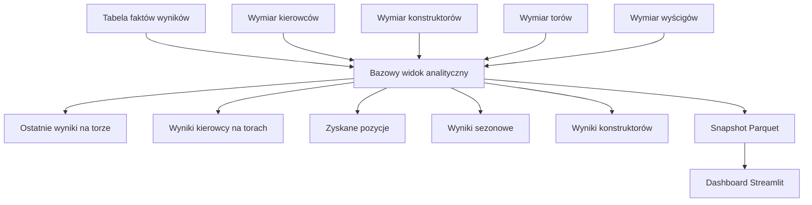

# Analityka biznesowa SQL

[English](../sql_business_analytics.md) | [Polski](sql_business_analytics.md)

## 1. Wprowadzenie

Warstwa analityczna udostępnia wielokrotnego użytku widoki SQL do analizy wyników Formuły 1 na podstawie modelu wymiarowego Gold.

Centralizuje logikę biznesową, zapewnia spójne definicje metryk i stanowi źródło przygotowanego zbioru danych dashboardu Streamlit.

## 2. Zbiór danych

| Metryka | Wartość |
|---|---:|
| Sezony historyczne | 2021–2025 |
| Wyścigi | 114 |
| Kierowcy | 35 |
| Konstruktorzy | 12 |
| Tory | 28 |
| Wyniki wyścigów | 2 278 |
| Łączna liczba punktów | 11 540,50 |

Wartości dotyczą pierwotnego zweryfikowanego zbioru historycznego.

Wyniki sprintów są wykluczone. Zagregowane punkty wyścigowe nie stanowią oficjalnej klasyfikacji mistrzostw.

## 3. Architektura analityczna

Widoki analityczne są zarejestrowane w schemacie Unity Catalog:

`f1_lakehouse.analytics`



Wykorzystano standardowe widoki SQL zamiast widoków materializowanych.

Widoki nie tworzą dodatkowych fizycznych kopii danych warstwy Gold.

## 4. Widoki analityczne

| Widok | Granularność | Przeznaczenie |
|---|---|---|
| vw_race_results | Kierowca w wyścigu | Bazowy zbiór analityczny |
| vw_driver_circuit_history | Kierowca w wyścigu | Ostatnie wyniki na torze |
| vw_driver_circuit_performance | Kierowca na torze | Porównanie torów |
| vw_driver_positions_gained | Kierowca | Zmiana pozycji |
| vw_driver_season_performance | Kierowca w sezonie | Trendy historyczne |
| vw_constructor_circuit_performance | Konstruktor na torze | Porównanie konstruktorów |

Widok bazowy łączy tabelę faktów Gold ze wszystkimi czterema wymiarami za pomocą INNER JOIN.

Klucz biznesowy składa się z `race_id` oraz `driver_id`.

## 5. Pytania biznesowe i przykładowe zapytania

### 5.1. Ostatnie wyniki kierowcy na torze

Jak kierowca radził sobie podczas trzech ostatnich występów na Silverstone?

```sql
SELECT
    season,
    race_name,
    driver_name,
    grid_position,
    finish_position,
    positions_gained,
    points,
    status
FROM f1_lakehouse.analytics.vw_driver_circuit_history
WHERE driver_id = 'max_verstappen'
    AND circuit_id = 'silverstone'
    AND recency_rank <= 3
ORDER BY recency_rank;
```

Widok wykorzystuje funkcję okna ROW_NUMBER do uporządkowania wyników dla każdej kombinacji kierowcy i toru.

Wyniki nieklasyfikowane są zachowywane.

### 5.2. Najlepsze tory kierowcy

Na których torach Max Verstappen osiąga najlepsze historyczne wyniki?

```sql
SELECT
    circuit_name,
    race_starts,
    total_points,
    avg_points_per_start,
    avg_finish_position,
    wins,
    podiums
FROM f1_lakehouse.analytics.vw_driver_circuit_performance
WHERE driver_id = 'max_verstappen'
    AND race_starts >= 3
ORDER BY
    avg_points_per_start DESC,
    race_starts DESC,
    circuit_id;
```

Średnia liczba punktów na start pozwala uwzględnić różną liczbę startów.

Minimum trzech startów ogranicza wpływ małych prób.

### 5.3. Średnia liczba zyskanych pozycji

Którzy kierowcy zyskują średnio najwięcej pozycji?

```sql
SELECT
    driver_name,
    valid_results,
    avg_grid_position,
    avg_finish_position,
    avg_positions_gained
FROM f1_lakehouse.analytics.vw_driver_positions_gained
WHERE valid_results >= 10
ORDER BY
    avg_positions_gained DESC,
    valid_results DESC,
    driver_id
LIMIT 10;
```

Zmiana pozycji jest obliczana według wzoru:

`grid_position - finish_position`

Uwzględniane są wyłącznie wyniki klasyfikowane z prawidłową dodatnią pozycją startową.

Metryka nie oznacza liczby manewrów wyprzedzania na torze.

### 5.4. Wyniki kierowcy w kolejnych sezonach

Jak zmieniały się wyniki kierowcy na przestrzeni sezonów?

```sql
SELECT
    season,
    driver_name,
    race_starts,
    total_points,
    avg_points_per_start,
    wins,
    podiums,
    points_yoy_change,
    avg_points_yoy_change
FROM f1_lakehouse.analytics.vw_driver_season_performance
WHERE driver_id = 'max_verstappen'
ORDER BY season;
```

Widok wykorzystuje funkcję LAG do pobierania metryk poprzedniego sezonu.

Zmiany rok do roku są obliczane wyłącznie dla następujących po sobie sezonów.

Niezdefiniowane zmiany są reprezentowane przez NULL.

### 5.5. Wyniki konstruktorów na torze

Którzy konstruktorzy osiągają najlepsze wyniki na Silverstone?

```sql
SELECT
    constructor_name,
    race_starts,
    total_points,
    avg_points_per_race,
    wins,
    podiums
FROM f1_lakehouse.analytics.vw_constructor_circuit_performance
WHERE circuit_id = 'silverstone'
    AND race_starts >= 3
ORDER BY
    avg_points_per_race DESC,
    race_starts DESC,
    constructor_id;
```

Unikalne identyfikatory wyścigów zapobiegają wielokrotnemu liczeniu występów konstruktora na podstawie wyników poszczególnych kierowców.

## 6. Definicje metryk biznesowych

| Metryka | Definicja |
|---|---|
| Występ kierowcy | Jeden zarejestrowany wynik |
| Start kierowcy | Wynik nieoznaczony jako DNS |
| Występ konstruktora | Unikalny wyścig z wynikiem konstruktora |
| Start konstruktora | Unikalny wyścig z co najmniej jednym startującym kierowcą |
| Średnia punktów na start | Średnia punktów ze startów kierowcy |
| Średnia punktów konstruktora | Suma punktów podzielona przez liczbę unikalnych występów |
| Średnia pozycja końcowa | Średnia klasyfikowanych pozycji końcowych |
| Zyskane pozycje | Prawidłowa pozycja startowa minus klasyfikowana pozycja końcowa |
| Wskaźnik zwycięstw | Zwycięstwa podzielone przez starty |
| Wskaźnik podium kierowcy | Podia podzielone przez starty kierowcy |
| Wskaźnik podium konstruktora | Wyścigi z podium podzielone przez starty konstruktora |
| Zmiana YoY | Różnica pomiędzy kolejnymi sezonami |

Niezdefiniowane średnie i wskaźniki są reprezentowane przez NULL.

## 7. Wykorzystane techniki SQL

- INNER JOIN
- GROUP BY
- Common Table Expressions (CTE)
- Funkcja okna ROW_NUMBER
- Funkcja okna LAG
- COUNT DISTINCT
- COUNT_IF
- CASE WHEN
- TRY_DIVIDE
- UNION ALL
- Porównania uwzględniające NULL
- CREATE OR REPLACE VIEW

## 8. Kontrola jakości danych

### Unikalność kluczy biznesowych

```sql
SELECT
    race_id,
    driver_id,
    COUNT(*) AS record_count
FROM f1_lakehouse.analytics.vw_race_results
GROUP BY race_id, driver_id
HAVING COUNT(*) > 1;
```

Oczekiwany wynik: zero wierszy.

### Uzgadnianie liczby rekordów i punktów

```sql
SELECT
    'Gold' AS layer,
    COUNT(*) AS records,
    SUM(points) AS total_points
FROM f1_lakehouse.gold.fact_race_results

UNION ALL

SELECT
    'Analytics',
    COUNT(*),
    SUM(points)
FROM f1_lakehouse.analytics.vw_race_results;
```

Oczekiwane wyniki dla pierwotnego zbioru:

| Warstwa | Rekordy | Łączna liczba punktów |
|---|---:|---:|
| Gold | 2 278 | 11 540,50 |
| Analytics | 2 278 | 11 540,50 |

### Nieprawidłowe punkty

```sql
SELECT COUNT(*) AS invalid_records
FROM f1_lakehouse.analytics.vw_race_results
WHERE points IS NULL OR points < 0;
```

Oczekiwany wynik: 0.

Dodatkowe zapytania walidacyjne sprawdzają spójność rankingów, zakresy metryk, spójność startów, uzgadnianie zmian pozycji oraz obliczenia rok do roku.

Wyniki zapytań walidacyjnych wymagają ręcznej kontroli tam, gdzie nie zaimplementowano automatycznego przerywania wykonania.

## 9. Integracja z dashboardem

Dashboard Streamlit wykorzystuje ręcznie wyeksportowany snapshot Parquet widoku `vw_race_results`.

Interaktywne filtrowanie i obliczanie KPI odbywa się lokalnie przy użyciu Pandas.

Analiza konstruktorów w dashboardzie przedstawia wyniki wybranego kierowcy w poszczególnych zespołach. Widok SQL dotyczący konstruktorów agreguje wyniki wszystkich kierowców danego konstruktora.

Nie należy utożsamiać tych dwóch perspektyw analitycznych.

## 10. Uruchomienie

Plik źródłowy:

[04_sql_business_analytics.sql](../../sql/04_sql_business_analytics.sql)

Upewnij się, że istnieją tabele Gold, zaimportuj plik SQL do Databricks i wykonaj komórki notebooka w odpowiedniej kolejności.

Widoki analityczne są również wdrażane przez Databricks Job w ramach pipeline'u End-to-End.

## 11. Ograniczenia

- Wyłącznie historyczne wyniki Grand Prix.
- Brak wyników sprintów i kwalifikacji.
- Identyfikatory konstruktorów zgodne ze źródłem.
- Rankingi zależne od wielkości próby.
- Brak możliwości odizolowania umiejętności kierowcy od osiągów samochodu.
- Nie wszystkie walidacje SQL automatycznie przerywają wykonanie.
- Ręczne odświeżanie snapshotu dashboardu.

## 12. Powiązana dokumentacja

- [Architektura rozwiązania](architecture.md)
- [Model wymiarowy Gold (EN)](../gold_dimensional_model.md)
- [Jakość danych i CI](data_quality_and_ci.md)
- [Dokumentacja dashboardu (EN)](../../dashboard/README.md)
- [Konfiguracja i odtwarzalność](setup.md)