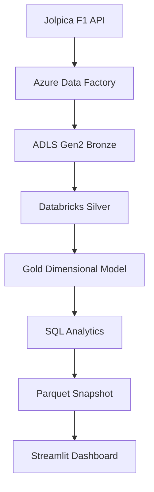
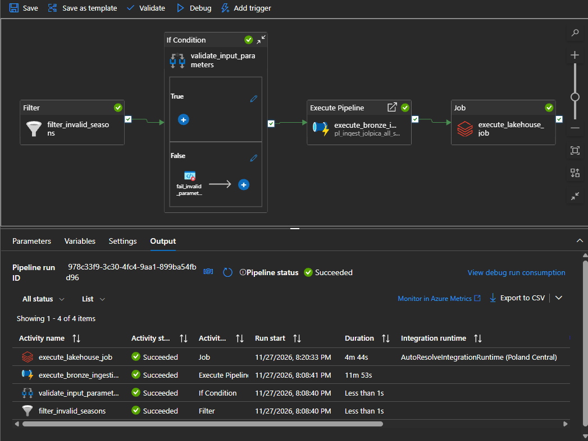
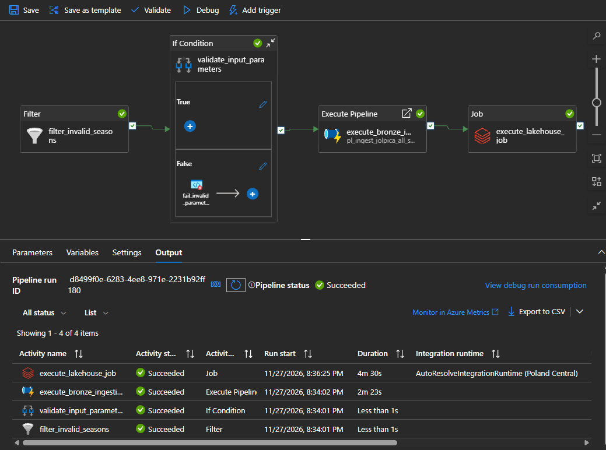
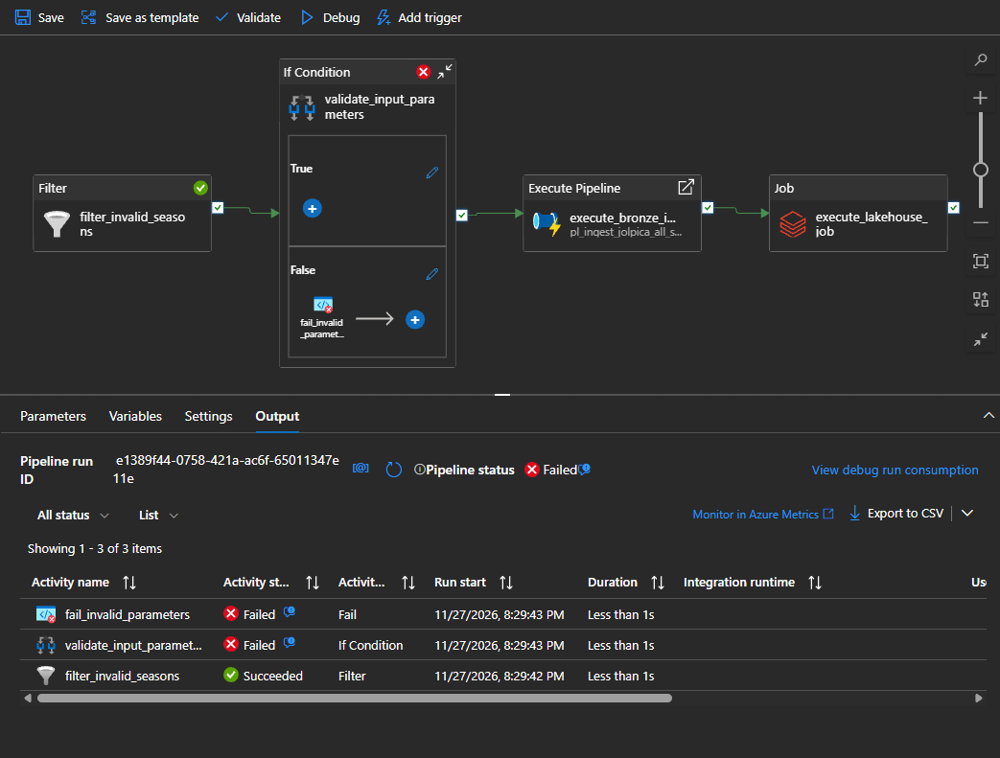
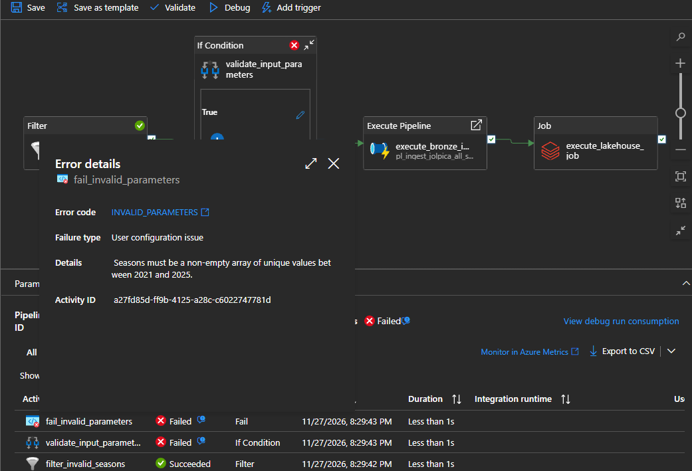
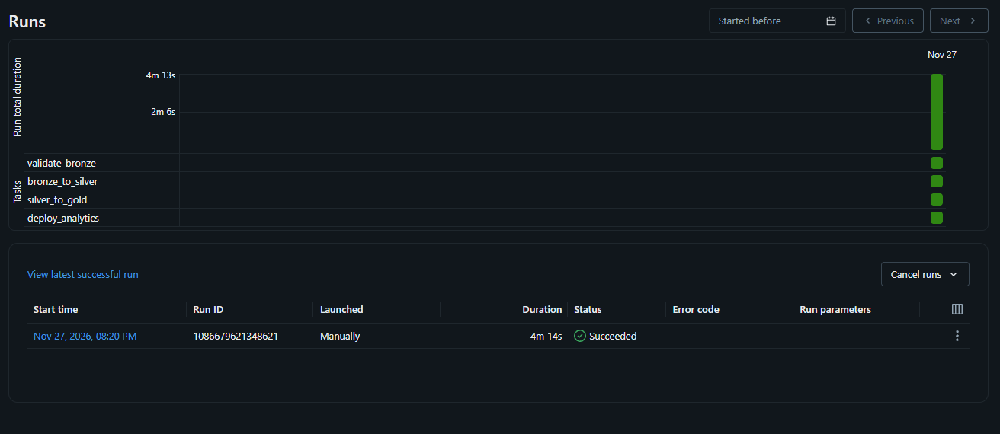
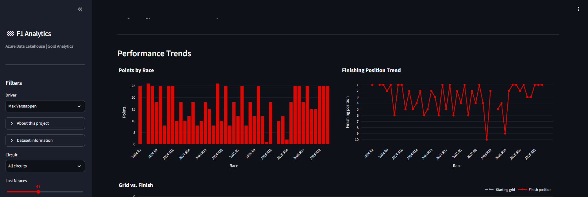
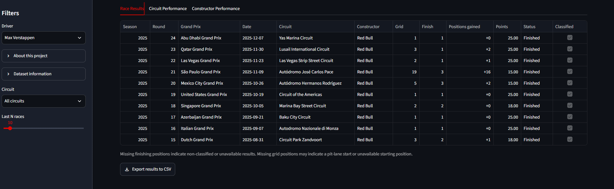
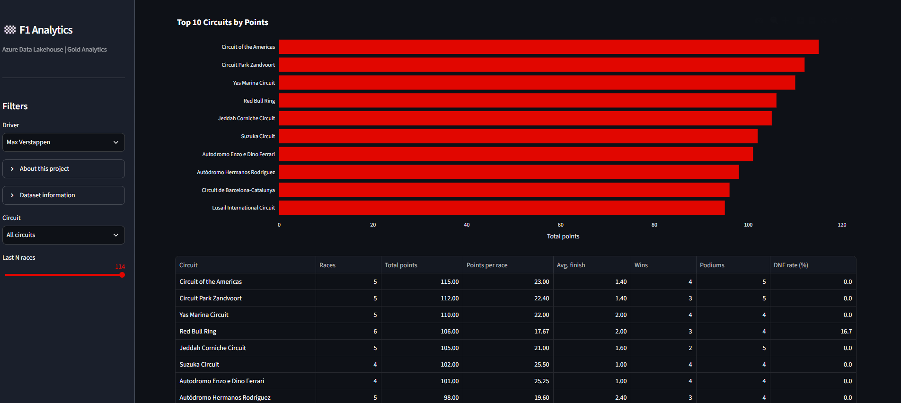
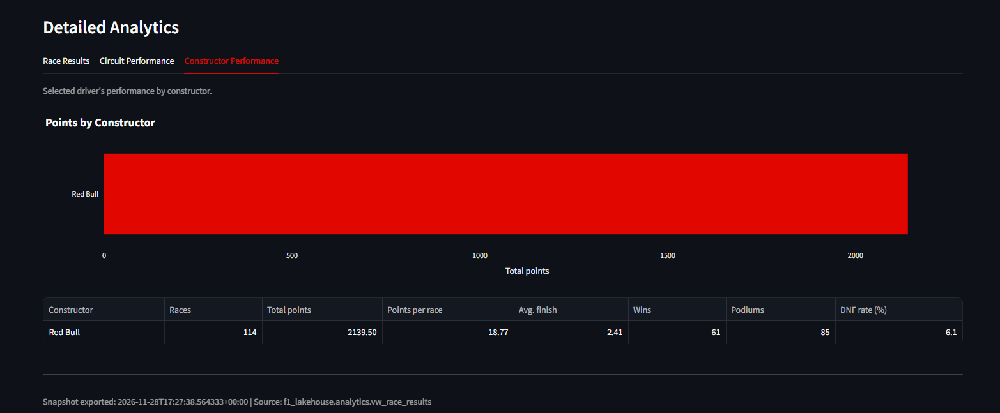

# Portfolio Demo and Execution Evidence

[English](portfolio_demo.md) | [Polski](pl/portfolio_demo.md)

## 1. Overview

This document presents execution evidence and application screenshots from the F1 Performance Analytics project.

The screenshots demonstrate the implemented Azure Data Lakehouse pipeline, orchestration, validation mechanisms and interactive analytical dashboard.

The project processes historical Formula 1 Grand Prix race results from the 2021–2025 seasons.

## 2. Solution Overview



## 3. Azure Data Factory

### 3.1. Successful End-to-End Execution



Demonstrated capabilities:

- Pipeline orchestration.
- Historical data ingestion.
- Activity dependency management.
- Databricks Job integration.
- End-to-end execution monitoring.

### 3.2. Selected Season Refresh



The orchestration pipeline supports refreshing selected historical seasons.

Silver and Gold transformations rebuild the complete historical dataset using the available Bronze data.

### 3.3. Invalid Parameter Handling



Invalid input parameters are rejected by the orchestration pipeline.

This demonstrates defensive validation and controlled failure handling.

### 3.4. Error Details



Execution diagnostics support troubleshooting and investigation of failed pipeline runs.

## 4. Azure Databricks

### 4.1. Successful Databricks Job



The Databricks Job orchestrates the processing stages:

1. Bronze validation.
2. Bronze-to-Silver transformation.
3. Silver-to-Gold transformation.
4. SQL analytics deployment.

The tasks execute according to their configured dependencies.

## 5. Validated Historical Dataset

| Metric | Value |
|---|---:|
| Historical seasons | 5 |
| Bronze JSON files | 25 |
| Grand Prix races | 114 |
| Drivers | 35 |
| Constructors | 12 |
| Circuits | 28 |
| Gold fact records | 2,278 |
| Analytical views | 6 |
| Duplicate business keys | 0 |
| Orphan foreign keys | 0 |
| Locally passed automated tests | 57 |

These values represent the validated MVP baseline.

They are historical development results rather than live monitoring metrics.

## 6. Streamlit Dashboard

The dashboard consumes a curated Parquet snapshot exported from the Gold analytics layer.

It can be executed locally without Azure credentials or active cloud compute resources.

### 6.1. Dashboard Overview


Interactive filters and key performance indicators provide an overview of the selected driver's historical race performance.

### 6.2. Performance Trends



Interactive Plotly charts visualize:

- Points per race.
- Finishing position trends.
- Starting grid versus finishing position.

### 6.3. Detailed Race Results



The results table presents historical race-level information and supports filtered CSV export.

### 6.4. Circuit Performance



Circuit-level aggregations enable comparison of the selected driver's historical performance across different tracks.

### 6.5. Constructor Performance



Constructor-level aggregations present the selected driver's results with different teams.

This is not an official constructor championship ranking.

## 7. Local Demonstration

From the repository root, using an activated Python virtual environment:

```bash
python -m pip install -r dashboard/requirements.txt
python -m streamlit run dashboard/app.py
```

Open:

http://localhost:8501

No Azure account is required for the local dashboard demonstration.

## 8. Suggested Portfolio Walkthrough

| Step | Demonstration |
|---|---|
| 1 | Explain the business problem and architecture |
| 2 | Present the ADF orchestration pipeline |
| 3 | Explain Databricks processing and the Medallion Architecture |
| 4 | Present the Gold dimensional model and SQL analytics |
| 5 | Discuss data quality and automated testing |
| 6 | Demonstrate the interactive Streamlit dashboard |
| 7 | Explain technical trade-offs and limitations |

## 9. Evidence Scope

The screenshots document development and validation executions of the implemented MVP.

They do not represent a continuously operating production service.

The dashboard uses a historical snapshot rather than a live connection to Azure.

Sprint and qualifying results are outside the current dataset scope.

## 10. Related Documentation

- [Solution Architecture](architecture.md)
- [Setup and Reproducibility](setup.md)
- [End-to-End Pipeline](end_to_end_pipeline.md)
- [SQL Business Analytics](sql_business_analytics.md)
- [Data Quality and CI](data_quality_and_ci.md)
- [Dashboard Documentation](../dashboard/README.md)
- [Main README](../README.md)