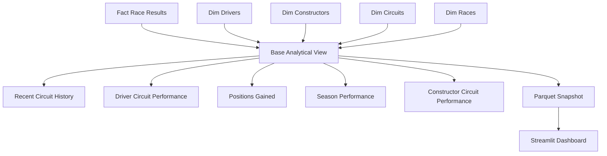

# SQL Business Analytics

[English](sql_business_analytics.md) | [Polski](pl/sql_business_analytics.md)

## 1. Overview

The analytics layer provides reusable SQL views for Formula 1 performance analysis based on the Gold dimensional model.

It centralizes business logic, provides consistent metric definitions and serves as the source of the curated Streamlit dashboard dataset.

## 2. Dataset

| Metric | Value |
|---|---:|
| Historical seasons | 2021–2025 |
| Races | 114 |
| Drivers | 35 |
| Constructors | 12 |
| Circuits | 28 |
| Race results | 2,278 |
| Total race points | 11,540.50 |

These values represent the original validated historical dataset.

Sprint results are excluded. Aggregated race points should not be interpreted as official championship standings.

## 3. Analytics Architecture

The analytical views are registered in the Unity Catalog schema:

`f1_lakehouse.analytics`



Standard SQL views are used instead of materialized views.

The views do not create additional physical copies of the underlying Gold tables.

## 4. Analytical Views

| View | Data grain | Purpose |
|---|---|---|
| vw_race_results | Driver per race | Base analytical dataset |
| vw_driver_circuit_history | Driver per race | Recent circuit performance |
| vw_driver_circuit_performance | Driver per circuit | Circuit comparison |
| vw_driver_positions_gained | Driver | Grid position improvement |
| vw_driver_season_performance | Driver per season | Historical trends |
| vw_constructor_circuit_performance | Constructor per circuit | Constructor comparison |

The base view joins the Gold fact table with all four dimensions using INNER JOIN operations.

Its composite business key consists of `race_id` and `driver_id`.

## 5. Business Questions and Example Queries

### 5.1. Recent Driver Circuit Performance

How has a driver performed in their last three race appearances at Silverstone?

```sql
SELECT
    season,
    race_name,
    driver_name,
    grid_position,
    finish_position,
    positions_gained,
    points,
    status
FROM f1_lakehouse.analytics.vw_driver_circuit_history
WHERE driver_id = 'max_verstappen'
    AND circuit_id = 'silverstone'
    AND recency_rank <= 3
ORDER BY recency_rank;
```

The view uses ROW_NUMBER to rank race entries within each driver and circuit combination.

Non-classified results are retained.

### 5.2. Strongest Driver Circuits

Which circuits provide the strongest historical results for Max Verstappen?

```sql
SELECT
    circuit_name,
    race_starts,
    total_points,
    avg_points_per_start,
    avg_finish_position,
    wins,
    podiums
FROM f1_lakehouse.analytics.vw_driver_circuit_performance
WHERE driver_id = 'max_verstappen'
    AND race_starts >= 3
ORDER BY
    avg_points_per_start DESC,
    race_starts DESC,
    circuit_id;
```

Average points per start is used to account for different numbers of race starts.

A minimum of three starts reduces the influence of small samples.

### 5.3. Average Positions Gained

Which drivers gain the most grid positions on average?

```sql
SELECT
    driver_name,
    valid_results,
    avg_grid_position,
    avg_finish_position,
    avg_positions_gained
FROM f1_lakehouse.analytics.vw_driver_positions_gained
WHERE valid_results >= 10
ORDER BY
    avg_positions_gained DESC,
    valid_results DESC,
    driver_id
LIMIT 10;
```

Positions gained are calculated as:

`grid_position - finish_position`

Only classified results with valid positive starting positions are included.

This metric does not represent the number of on-track overtakes.

### 5.4. Driver Season Performance

How has driver performance changed across seasons?

```sql
SELECT
    season,
    driver_name,
    race_starts,
    total_points,
    avg_points_per_start,
    wins,
    podiums,
    points_yoy_change,
    avg_points_yoy_change
FROM f1_lakehouse.analytics.vw_driver_season_performance
WHERE driver_id = 'max_verstappen'
ORDER BY season;
```

The view uses LAG to retrieve previous-season metrics.

Year-over-year changes are calculated only for consecutive seasons.

Undefined changes are represented by NULL values.

### 5.5. Constructor Circuit Performance

Which constructors perform best at Silverstone?

```sql
SELECT
    constructor_name,
    race_starts,
    total_points,
    avg_points_per_race,
    wins,
    podiums
FROM f1_lakehouse.analytics.vw_constructor_circuit_performance
WHERE circuit_id = 'silverstone'
    AND race_starts >= 3
ORDER BY
    avg_points_per_race DESC,
    race_starts DESC,
    constructor_id;
```

Distinct race identifiers prevent multiple driver results from being counted as separate constructor race appearances.

## 6. Business Metric Definitions

| Metric | Definition |
|---|---|
| Race entry | One recorded driver result |
| Driver start | Race entry not marked as DNS |
| Constructor appearance | Distinct race with a recorded constructor result |
| Constructor start | Distinct race with at least one driver starting |
| Average points per start | Average points across driver starts |
| Average constructor points per race | Total points divided by distinct race appearances |
| Average finish | Average classified finishing position |
| Positions gained | Valid grid position minus classified finish |
| Win rate | Wins divided by starts |
| Driver podium rate | Podiums divided by driver starts |
| Constructor podium race rate | Races with a podium divided by constructor starts |
| YoY change | Difference between consecutive seasons |

Undefined averages and ratios are represented by NULL values.

## 7. SQL Techniques

- INNER JOIN
- GROUP BY
- Common Table Expressions
- ROW_NUMBER window function
- LAG window function
- COUNT DISTINCT
- COUNT_IF
- CASE WHEN
- TRY_DIVIDE
- UNION ALL
- Null-safe equality
- CREATE OR REPLACE VIEW

## 8. Data Quality Checks

### Business Key Uniqueness

```sql
SELECT
    race_id,
    driver_id,
    COUNT(*) AS record_count
FROM f1_lakehouse.analytics.vw_race_results
GROUP BY race_id, driver_id
HAVING COUNT(*) > 1;
```

Expected result: zero rows.

### Record Count and Points Reconciliation

```sql
SELECT
    'Gold' AS layer,
    COUNT(*) AS records,
    SUM(points) AS total_points
FROM f1_lakehouse.gold.fact_race_results

UNION ALL

SELECT
    'Analytics',
    COUNT(*),
    SUM(points)
FROM f1_lakehouse.analytics.vw_race_results;
```

Expected results for the original dataset:

| Layer | Records | Total points |
|---|---:|---:|
| Gold | 2,278 | 11,540.50 |
| Analytics | 2,278 | 11,540.50 |

### Invalid Points

```sql
SELECT COUNT(*) AS invalid_records
FROM f1_lakehouse.analytics.vw_race_results
WHERE points IS NULL OR points < 0;
```

Expected result: 0.

Additional validation queries in the SQL source cover ranking consistency, metric ranges, race start consistency, positions gained reconciliation and year-over-year calculations.

SQL validation results require manual inspection where explicit failure enforcement is not implemented.

## 9. Dashboard Integration

The Streamlit dashboard consumes a manually exported Parquet snapshot of `vw_race_results`.

Interactive filtering and KPI calculations are performed locally using Pandas.

The dashboard constructor analysis represents the selected driver's performance with each constructor. The SQL constructor circuit view represents aggregated constructor performance across drivers.

These analytical perspectives should not be treated as identical.

## 10. Execution

Source file:

[04_sql_business_analytics.sql](../sql/04_sql_business_analytics.sql)

Ensure that the Gold tables exist, import the SQL source into Databricks and execute the notebook cells in order.

The end-to-end Databricks Job also deploys the analytical views.

## 11. Limitations

- Historical Grand Prix race results only.
- Sprint and qualifying results are excluded.
- Historical constructor identities follow source identifiers.
- Ranking results depend on sample size.
- Driver ability cannot be isolated from car performance.
- SQL validation queries do not all enforce automatic failure.
- The dashboard snapshot is refreshed manually.

## 12. Related Documentation

- [Solution Architecture](architecture.md)
- [Gold Dimensional Model](gold_dimensional_model.md)
- [Data Quality and CI](data_quality_and_ci.md)
- [Dashboard Documentation](../dashboard/README.md)
- [Setup and Reproducibility](setup.md)